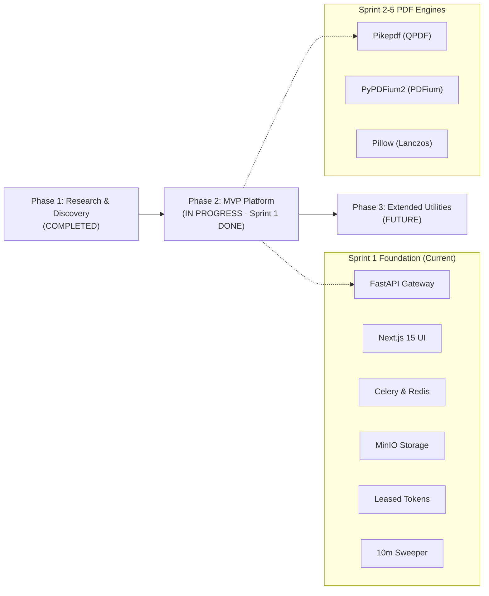
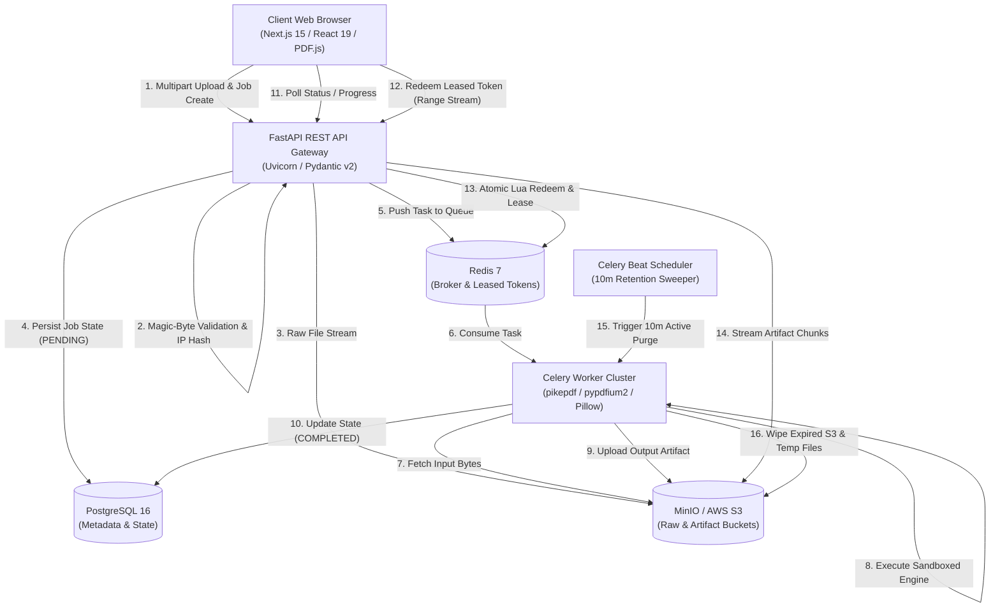

# PDFKarlo Platform — Project Overview

> **Document ID:** DOC-01-OVERVIEW  
> **Status:** Approved Baseline  
> **Version:** 1.0.0  
> **Date:** November 12, 2026  
> **Source Repository:** `E:\REA`

---

## 1. Executive Summary

The **PDFKarlo Platform** is an independently engineered, high-performance, privacy-first PDF processing platform designed to provide fast, reliable, and secure document manipulation tools. Benchmarked against industry market leaders like [iLovePDF](https://www.ilovepdf.com/), PDFKarlo provides an alternative built on a **100% permissive open-source foundation (Apache-2.0, MIT, BSD)** that completely eliminates copyleft/AGPL licensing risks.

The platform architecture decouples interactive client-side document preparation (powered by Next.js 15, React 19, and Mozilla PDF.js) from an asynchronous backend service mesh (FastAPI, Celery, Redis, PostgreSQL 16, and MinIO/S3 object storage).

---

## 2. Competitive Benchmark & Differentiation

### 2.1 Competitive Benchmark: iLovePDF
Based on Phase 1 research ([`research/product-overview.md`](file:///E:/REA/research/product-overview.md)), the reference product delivers 33 PDF utilities across five primary operational categories (Organize, Optimize, Convert to PDF, Convert from PDF, and Edit/Security). However, proprietary commercial platforms exhibit key architectural and licensing limitations:
- **Opaque Infrastructure & Licensing:** Commercial SaaS engines rely on proprietary or closed wrappers, frequently bundling AGPL components (such as Ghostscript or MuPDF) that prevent clean enterprise white-labeling or self-hosted distribution.
- **Data Privacy Concerns:** Uploaded files on public platforms are subjected to varied retention policies (e.g. iLovePDF's publicly advertised 2-hour retention) with undocumented server-side handling and raw client IP logging.
- **Aggressive Paywalls:** Advanced compression, batch processing, and high-DPI rasterization are locked behind subscriptions or credit meters.

### 2.2 PDFKarlo Platform Differentiation Matrix

| Dimension | Industry Benchmark (iLovePDF) | PDFKarlo Platform |
| :--- | :--- | :--- |
| **Source & Licensing** | Proprietary closed-source SaaS | 100% Permissive Open Source (Apache-2.0 / MIT / BSD) |
| **Copyleft Risk** | Undisclosed (potential AGPL dependencies) | **Zero AGPL Exposure** (enforced by automated CI license gating) |
| **Data Retention** | Advertised 2-hour auto-deletion | **Guaranteed 2-Hour SLA** backed by an active 10-minute Celery Beat sweeper |
| **Download Security** | Static or long-lived download URLs | **Atomic Leased Token Protocol** (15m base TTL, 120s lease window, 3 retries max) |
| **File Ingestion** | Standard HTTP upload | **Magic-Byte Binary Inspection** enforcing genuine `%PDF-` and image signatures |
| **Client Privacy** | Raw IP logging & tracking cookies | **GDPR Pseudonymization** using salted SHA-256 client IP hashing |
| **Client Rendering** | Server-side thumbnail rendering | **Hybrid Client-Side PDF.js Rendering** reducing server load and bandwidth |
| **Extensibility** | Closed ecosystem / proprietary API | Clean REST API Gateway with OpenAPI v3 specification |

---

## 3. Product Scope & Phasing

### 3.1 Phase 1 — Research & Evidence Verification (Completed)
- Exhaustive audit of tool taxonomies, pricing models, upload workflows, and licensing constraints.
- Formulated the 30-section Master PRD ([`research/MVP-PRD.md`](file:///E:/REA/research/MVP-PRD.md)) and Architecture Decision Record ([`research/architecture-decision-record.md`](file:///E:/REA/research/architecture-decision-record.md)).

### 3.2 Phase 2 — Core MVP Platform (10 Tools)
The MVP targets the 10 most critical PDF operations:
1. **Merge PDF**: Concatenate multiple PDF documents in user-specified sequence.
2. **Split PDF**: Extract page ranges or burst into single-page documents.
3. **Rotate PDF**: Orient pages by 90, 180, or 270 degrees permanently.
4. **Reorder Pages**: Visual drag-and-drop page resequencing.
5. **Remove Pages**: Selective deletion of confidential or redundant pages.
6. **Compress PDF**: Hybrid raster downsampling (Lanczos) and structural stream compaction.
7. **JPG to PDF**: Convert raster images to clean vector-encapsulated PDF documents.
8. **PDF to JPG**: High-fidelity page rasterization via Google PDFium.
9. **Protect PDF**: Standard AES-256 document password encryption.
10. **Unlock PDF**: Remove user/owner passwords and permission restrictions from authorized documents.

### 3.3 Phase 3 — Enterprise & Extended Utilities (Future Roadmap)
- OCR text recognition (Tesseract / OCRmyPDF).
- Office to PDF conversion (Gotenberg / LibreOffice headless).
- Digital signatures and PDF/A archiving.
- Team workspaces and webhook notifications.

---

## 4. User Personas & Core Journeys

### 4.1 Casual Utility User ("Sarah", Student / Researcher)
- **Goal:** Quickly combine lecture slides, rotate scanned assignments, and reduce file sizes for upload portals.
- **Needs:** Zero registration, drag-and-drop interface, instant preview, fast processing (< 3s).
- **Security Expectation:** Documents are private and vanish immediately after download.

### 4.2 Corporate Privacy User ("David", Legal / Compliance Analyst)
- **Goal:** Remove sensitive pages from contracts, apply AES-256 encryption, and redact documents.
- **Needs:** Documented retention policies, transparent infrastructure, zero third-party telemetry, single-tenant sandboxed execution.

### 4.3 Developer API Client ("Elena", Systems Architect)
- **Goal:** Automate document merging, PDF to image rendering, and report archiving within external applications.
- **Needs:** Idempotent REST API endpoints, deterministic error codes, webhook callbacks, clear OpenAPI specifications.

---

## 5. Architectural Topology

---

## 6. Project Directory & Artifact Map

- **Research Artifacts:** [`E:\REA\research\`](file:///E:/REA/research/)
  - Master PRD: [`research/MVP-PRD.md`](file:///E:/REA/research/MVP-PRD.md)
  - ADR-001 (Rev 3): [`research/architecture-decision-record.md`](file:///E:/REA/research/architecture-decision-record.md)
  - Final Architecture Review: [`research/final-architecture-review.md`](file:///E:/REA/research/final-architecture-review.md)
- **Technical Documentation:** [`E:\REA\documentation\`](file:///E:/REA/documentation/)
  - `01-project-overview.md` (This document)
  - `02-sprint-1-completion-report.md`
  - `03-architecture-and-technology-stack.md`
  - `04-developer-setup-handbook.md`
  - `05-api-and-database-reference.md`
  - `06-testing-and-verification.md`
  - `07-sprint-progress-and-roadmap.md`
- **Application Codebase:**
  - Frontend: [`apps/web/`](file:///E:/REA/apps/web/)
  - API Gateway: [`apps/api/`](file:///E:/REA/apps/api/)
  - Task Worker: [`apps/worker/`](file:///E:/REA/apps/worker/)
  - Orchestration: [`infra/docker/`](file:///E:/REA/infra/docker/)
  - Test Suite: [`tests/`](file:///E:/REA/tests/)
