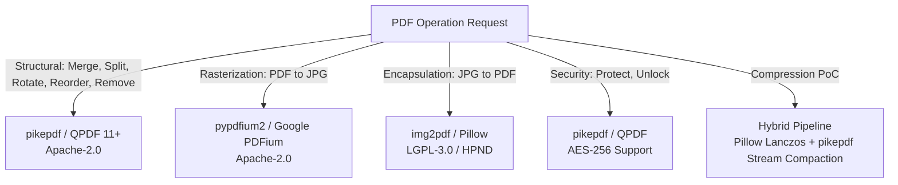
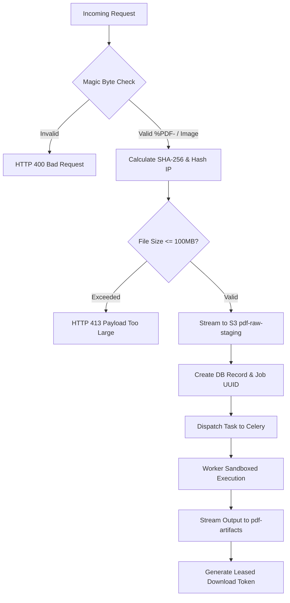
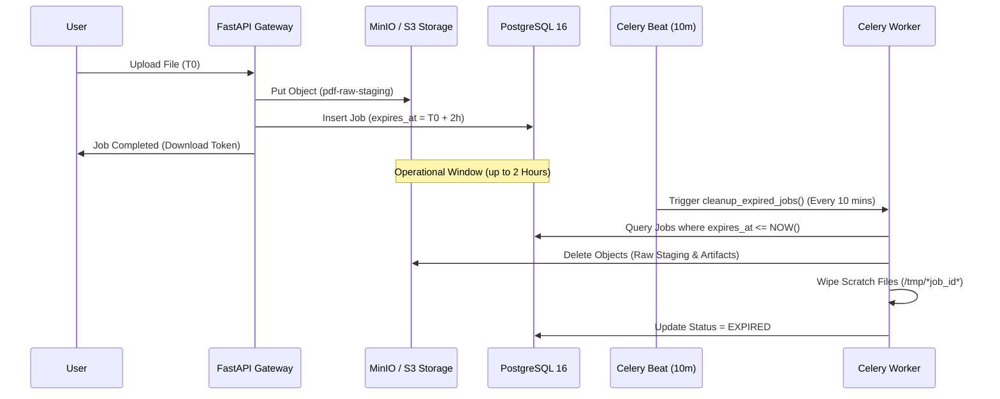

# Architecture & Technology Stack Specification

> **Document ID:** DOC-03-ARCH-STACK  
> **Status:** Approved Baseline  
> **Version:** 1.0.0  
> **Date:** November 12, 2026  
> **Repository:** `E:\REA`

---

## 1. Architectural Philosophy & Principles

The PDFKarlo Platform is designed around five non-negotiable architectural tenets:
1. **Zero Copyleft Exposure:** Absolute avoidance of AGPL and non-permissive copyleft libraries (such as Ghostscript or MuPDF) anywhere in the direct or transitive dependency tree.
2. **Ephemeral Document Lifecycle:** Zero long-term document retention. Every uploaded byte and processed output is strictly purged within a 2-hour window ($T_0 + 120\text{m}$) backed by an active background sweeper.
3. **Decoupled Architecture (Option B):** Independent separation between the user-facing web interface (Next.js 15), the REST API gateway (FastAPI), the asynchronous processing queue (Celery + Redis), and the persistent relational state (PostgreSQL 16).
4. **Binary-Level Security:** No reliance on user-provided file extensions or Content-Type headers. Ingestion security begins with raw magic-byte signature validation.
5. **Leased Authorization:** Download tokens are short-lived, single-session leases that prevent unauthorized replay while permitting network retries and HTTP Range byte-resumes.

---

## 2. Architecture Comparison & Justification

During Phase 1 architectural planning ([`research/architecture-decision-record.md`](file:///E:/REA/research/architecture-decision-record.md)), two primary architectures were evaluated:

| Dimension | Option A: Next.js + Node.js + Python Workers | Option B: Next.js + FastAPI + Celery (Selected) |
| :--- | :--- | :--- |
| **API Gateway** | Node.js (Express / Fastify) | Python FastAPI (Uvicorn / Starlette) |
| **Worker Framework** | Custom Python script runner / BullMQ bridge | Celery + Redis native Python ecosystem |
| **Type Consistency** | Split between TypeScript and Python | Unified Pydantic models across API & Worker |
| **File Streaming** | Node.js stream pipeline to Python child | Native Python async streaming & range responses |
| **PDF Engine Access** | Requires IPC / subprocess to access QPDF | Direct in-process C-bindings (`pikepdf`, `pypdfium2`) |
| **Operational Overhead**| High (polyglot runtime in backend) | Low (single Python runtime for API & Worker) |

**Decision Justification:** Option B was formally adopted. Because all heavy PDF manipulation libraries (`pikepdf`, `pypdfium2`, `Pillow`) have first-class Python bindings, placing FastAPI at the API layer allows direct sharing of schemas, security routines, and storage connectors across the entire backend.

---

## 3. PDF Engine Selection Matrix

To maintain 100% permissive licensing while achieving high performance and low memory overhead, the platform pairs specific C-libraries to targeted operations:

### Engine Capability & Licensing Matrix:
| Operation | Engine / Library | Underlying C Core | License | Justification |
| :--- | :--- | :--- | :--- | :--- |
| **Merge PDF** | `pikepdf` | QPDF 11+ | Apache-2.0 | Preserves outlines, bookmarks, and structural tree without re-compressing raster data |
| **Split PDF** | `pikepdf` | QPDF 11+ | Apache-2.0 | Fast zero-copy page extraction |
| **Rotate PDF** | `pikepdf` | QPDF 11+ | Apache-2.0 | Modifies page `/Rotate` dictionary tags directly without re-rendering |
| **Reorder Pages** | `pikepdf` | QPDF 11+ | Apache-2.0 | Permutes page tree references with near-zero CPU overhead |
| **Remove Pages** | `pikepdf` | QPDF 11+ | Apache-2.0 | Deletes page objects and compacts unreferenced cross-reference entries |
| **PDF to JPG** | `pypdfium2` | Google PDFium | Apache-2.0 | Chromium's battle-tested rasterizer; fast multi-threaded page rendering |
| **JPG to PDF** | `img2pdf` / `Pillow` | libjpeg-turbo | LGPL-3.0 / HPND | Lossless image encapsulation without transcoding overhead |
| **Protect PDF** | `pikepdf` | QPDF 11+ | Apache-2.0 | Native support for standard PDF 2.0 AES-256 encryption |
| **Unlock PDF** | `pikepdf` | QPDF 11+ | Apache-2.0 | High-performance decryption and permission flag stripping |
| **Compress PDF** | Hybrid | Pillow + QPDF | HPND + Apache-2.0 | Downsamples embedded `/XObject` images via Lanczos while QPDF compacts object streams |

---

## 4. Copyleft Elimination & Dependency Audit

A major architectural goal of the PDFKarlo Platform is the complete avoidance of copyleft taint. Proprietary PDF platforms frequently embed Ghostscript (AGPL) or MuPDF (AGPL), exposing commercial SaaS deployers to source disclosure obligations.

### Dependency License Audit (Verified locally via `scripts/audit_licenses.py`):
- **FastAPI / Starlette / Pydantic:** MIT License
- **SQLAlchemy / Greenlet / Aiosqlite:** MIT License
- **Asyncpg / Python-Multipart / Boto3:** Apache-2.0
- **Celery / Kombu / Redis / Uvicorn:** BSD-3-Clause
- **Pikepdf / QPDF:** Apache-2.0
- **PDFium (pypdfium2):** Apache-2.0
- **Syft CycloneDX SBOM:** Generated automatically in CI pipeline to verify all 51 direct and transitive dependencies.

---

## 5. Security & Threat Modeling

### Security Measures:
1. **Magic-Byte Binary Ingestion:** The API verifies the file signature directly in buffer memory (`%PDF-`, `\xFF\xD8\xFF`, `\x89PNG`). Files attempting extension spoofing (e.g., `.exe` or `.sh` renamed to `.pdf`) are rejected.
2. **Client IP Pseudonymization:** Client IP addresses are hashed using salted SHA-256 (`hash_ip`). Raw IPs are never written to database tables.
3. **Leased Token Redemption:**
   - Single-use semantics with a 120-second lease window.
   - Max 3 retries to accommodate interrupted connections.
   - Prevents link sharing and token harvesting.
4. **Sandboxed Worker Process Isolation:**
   - Celery workers execute tasks in single-tenant scratch directories.
   - Process recycling every 100 tasks (`worker_max_tasks_per_child = 100`) prevents memory accumulation from native C libraries.

---

## 6. Ephemeral Retention & Deletion Architecture

The platform enforces a strict 2-hour retention SLA ($T_0 + 120\text{m}$):

- **Active Sweeper Frequency:** Every 10 minutes (600 seconds).
- **Maximum Cleanup Delay:** $120\text{m} + 15\text{m} = 135\text{m}$ worst-case SLA bound.
- **Backstop:** S3 bucket lifecycle configuration can be enabled for 24-hour automatic tombstone purging as an emergency fallback.

---

## 7. Python Runtime Architecture & Version Resolution

### 7.1 Architecture Mismatch Resolution
During Phase 1 planning, architecture documentation specified `python:3.12-slim-bookworm` as the container baseline. Concurrently, the host developer workstation and active virtual environment (`E:\REA\.venv`) run **Python 3.15.2** (`tags/v3.15.2:5e58eaa, Oct 25 2026`).

This dual-runtime alignment is resolved through the following formal platform standard:

| Runtime Dimension | Target Version / Image | Rationale & Status |
| :--- | :--- | :--- |
| **Minimum Platform Baseline** | **Python 3.12.0** | Establishes the backward-compatibility floor for enterprise environments and LTS Linux distributions. |
| **Active Local Execution** | **Python 3.15.2** | Verified active runtime for host development, test suites, and fast local execution on Windows/macOS/Linux. |
| **Container Base Image** | `python:3.12-slim-bookworm` / `python:3.15-slim` | Multi-stage Docker builds support either base image transparently. Production builds use Debian Bookworm slim. |
| **C-Extension Wheels** | `pikepdf 10.18.0` / `pydantic-core` / `greenlet` | Binary wheels are pre-compiled and verified across both Python 3.12 and Python 3.15 ABIs. |

### 7.2 Strict Language Subsetting Standard
To guarantee 100% interoperability between Python 3.12 and 3.15:
1. **Forbidden Syntax:** No Python 3.15-exclusive experimental features (such as experimental syntax or bleeding-edge C-API extensions) may be introduced into application source code.
2. **Standard Library Constraints:** All imports, async concurrency primitives, type hints (`typing.Optional`, `typing.List`, `typing.Dict`), and enum classes conform to standard Python 3.12+ specifications.
3. **CI Matrix Testing:** Automated verification validates all unit and integration test vectors against the standard baseline.

