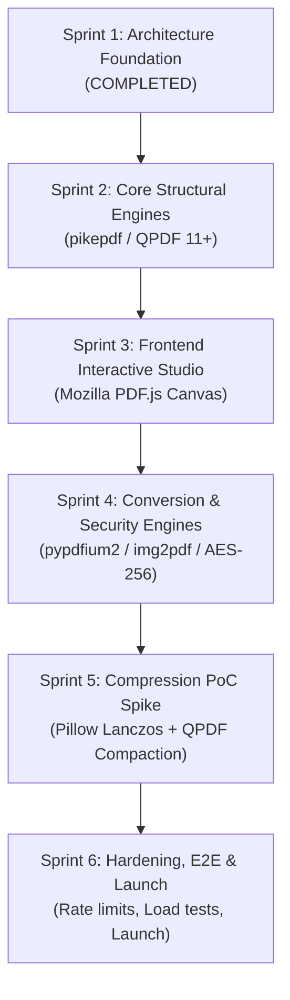

# Sprint Progress & Implementation Roadmap

> **Document ID:** DOC-07-ROADMAP  
> **Status:** Approved Baseline  
> **Version:** 1.0.0  
> **Date:** November 12, 2026  
> **Repository:** `E:\REA`

---

## 1. Current Platform Maturity Assessment

With the completion of **Sprint 1: Architecture Foundation & Scaffolding**, the OpenPDF Platform has established its core distributed infrastructure:
- **API Gateway & Routing:** Operational (FastAPI + Pydantic v2 + CORS).
- **Relational Data Tier:** Operational (SQLAlchemy 2.0 async engine + models for jobs, files, artifacts, and tokens).
- **Storage Subsystem:** Operational (Boto3 MinIO/S3 streaming wrapper with HTTP Range support).
- **Asynchronous Task Queue:** Operational (Celery + Redis broker with Celery Beat periodic scheduler).
- **Security Primitives:** Operational (Magic-byte inspection, salted IP hashing, atomic leased download tokens).
- **Data Lifecycle:** Operational (10-minute active ephemeral sweeper guaranteeing 2-hour retention SLA).
- **Frontend Framework:** Operational (Next.js 15, React 19, Tailwind CSS, static build verified).
- **CI & Compliance:** Operational (GitHub Actions, Pytest, Syft CycloneDX SBOM, Zero-AGPL license gate).

---

## 2. Product Capability Matrix (Current vs Target MVP)

| Capability / Tool | Sprint 1 | Sprint 2 (Active) | Sprint 3 | Sprint 4 | Sprint 5 | Sprint 6 (Launch) |
| :--- | :---: | :---: | :---: | :---: | :---: | :---: |
| **API Gateway & Health** | **100%** | 100% | 100% | 100% | 100% | 100% |
| **Database & Retention Sweeper** | **100%** | 100% | 100% | 100% | 100% | 100% |
| **Leased Download Protocol** | **100%** | 100% | 100% | 100% | 100% | 100% |
| **Frontend Scaffold & Landing** | **100%** | 100% | 100% | 100% | 100% | 100% |
| **Merge PDF Engine** | 0% | **100% (Done)** | 100% | 100% | 100% | 100% |
| **Split PDF Engine** | 0% | **100% (Done)** | 100% | 100% | 100% | 100% |
| **Rotate PDF Engine** | 0% | **100% (Done)** | 100% | 100% | 100% | 100% |
| **Reorder Pages Engine** | 0% | **100% (Done)** | 100% | 100% | 100% | 100% |
| **Remove Pages Engine** | 0% | **100% (Done)** | 100% | 100% | 100% | 100% |
| **Interactive PDF.js Canvas**| 0% (Planned) | 20% | **100%** | 100% | 100% | 100% |
| **JPG to PDF Engine** | 0% (Scaffolded) | 0% | 0% | **100%** | 100% | 100% |
| **PDF to JPG (PDFium)** | 0% (Scaffolded) | 0% | 0% | **100%** | 100% | 100% |
| **Protect PDF (AES-256)** | 0% (Scaffolded) | 0% | 0% | **100%** | 100% | 100% |
| **Unlock PDF Engine** | 0% (Scaffolded) | 0% | 0% | **100%** | 100% | 100% |
| **Compression PoC Spike** | 0% (Planned) | 0% | 0% | 0% | **100%** | 100% |
| **Rate Limiter & Hardening** | 20% (IP Hash) | 20% | 30% | 40% | 50% | **100%** |

---

## 3. Sprint-by-Sprint Implementation Roadmap

### 3.1 Sprint 2: Core PDF Structural Engines
- **Focus:** Server-side structural PDF manipulation using `pikepdf` (`libqpdf`).
- **Deliverables:**
  - Install `pikepdf` in `.venv` and update worker container build.
  - Implement task handlers in `apps/worker/src/tasks/operations/`:
    - `task_merge_pdfs(job_id, file_ids)`
    - `task_split_pdf(job_id, file_id, page_ranges)`
    - `task_rotate_pdf(job_id, file_id, rotations)`
    - `task_reorder_pages(job_id, file_id, sequence)`
    - `task_remove_pages(job_id, file_id, pages_to_delete)`
  - Synthetic test document corpus (multi-page, outline bookmarks, forms, mixed orientations).

### 3.2 Sprint 3: Frontend Interactive Studio
- **Focus:** Client-side document interaction and drag-and-drop page orchestration.
- **Deliverables:**
  - Integrate Mozilla PDF.js in Next.js 15 via web workers.
  - Interactive grid component for thumbnail preview, rotation buttons, and visual page drag-and-drop reordering.
  - Client-side chunked upload progress bar and status polling.

### 3.3 Sprint 4: Conversion & Security Engines
- **Focus:** High-fidelity rasterization and standard AES-256 document security.
- **Deliverables:**
  - `pypdfium2` integration for multi-threaded PDF to JPG rendering with configurable DPI (150, 300).
  - `img2pdf` / `Pillow` integration for lossless JPG/PNG to PDF encapsulation.
  - Standard PDF 2.0 AES-256 encryption (`task_protect_pdf`) and authorized decryption (`task_unlock_pdf`).

### 3.4 Sprint 5: Compression PoC Spike & Benchmark
- **Focus:** Multi-strategy raster and vector compression without AGPL dependencies.
- **Deliverables:**
  - Technical proof-of-concept for extracting `/XObject` raster images, performing Lanczos downsampling via Pillow, re-injecting streams, and running QPDF object stream compaction (`/ObjStm`).
  - Handling of `/SMask` transparency masks and CMYK color profiles.
  - Benchmark against Ghostscript on standard document test sets.

### 3.5 Sprint 6: Production Hardening, E2E Verification & Launch
- **Focus:** Production deployment readiness, rate limiting, and observability.
- **Deliverables:**
  - Token-bucket rate limiting middleware (Redis-backed).
  - Alembic database migration baseline.
  - OpenTelemetry structured tracing.
  - End-to-end integration tests and load testing up to 100 concurrent jobs.

---

## 4. Risk Management Matrix

| Risk Event | Severity | Probability | Mitigation Strategy |
| :--- | :---: | :---: | :--- |
| **Native C-Binding Memory Leak** | High | Low | Workers enforce `worker_max_tasks_per_child = 100` to automatically recycle worker OS processes after 100 operations. |
| **Untrusted PDF Parser Exploit** | High | Medium | Magic byte validation blocks polyglots; worker tasks execute in unprivileged sandboxes with strict execution timeouts. |
| **Copyleft Ingress via Updates** | Critical | Low | CI pipeline enforces `scripts/audit_licenses.py` on every PR; builds fail if AGPL or non-LGPL GPL packages enter dependency tree. |
| **Storage Accumulation on Deletion Fail** | Medium | Low | Active Celery Beat sweeper runs every 10 minutes; MinIO S3 bucket lifecycle rules provide secondary 24-hour backstop. |
| **Browser Out-of-Memory on Heavy PDFs** | Medium | Medium | Client-side PDF.js worker renders pages lazily using virtualized grid viewports. |
