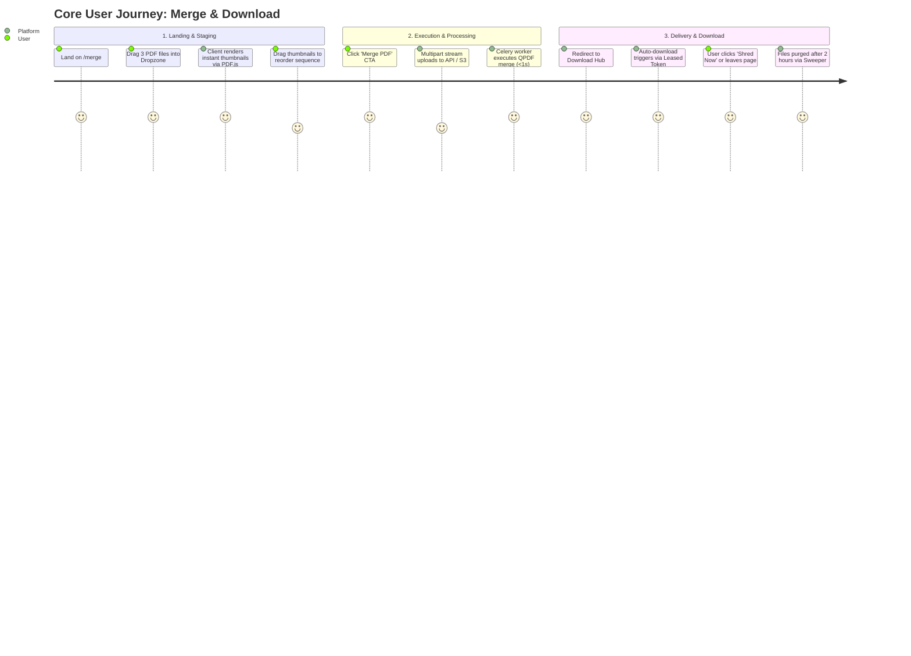
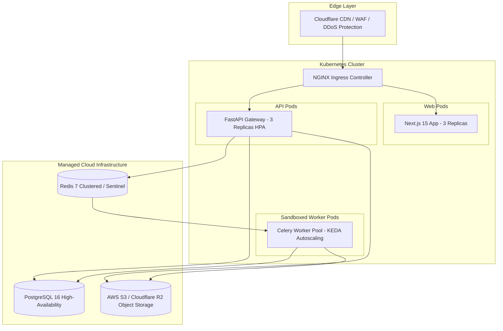

# Product Requirements Document (PRD): MVP Release

**Document Title:** Master Product Requirements Document — Independent PDF Platform  
**Document ID:** PRD-001 (MVP Release)  
**Status:** Approved for Implementation (Sprint 1 Active)  
**Date:** November 2026  
**Product Reference Benchmark:** [iLovePDF (ilovepdf.com)](https://www.ilovepdf.com/)  
**Source Baseline:** [`ADR-001 (Revision 3)`](file:///e:/REA/research/architecture-decision-record.md) | [`Implementation Plan`](file:///e:/REA/research/mvp-implementation-plan.md) | [`FAR-001`](file:///e:/REA/research/final-architecture-review.md) | [`Evidence Register`](file:///e:/REA/research/evidence-register.md)  
**Author:** Senior Product Analyst & Software Architect  

---

## 1. Executive Summary

This Master PRD establishes the single source of truth for the Phase 2 MVP development of an independently engineered, cloud-native PDF processing platform. Informed by rigorous competitive analysis of iLovePDF and validated by ADR-001 Revision 3, the platform delivers zero-friction, browser-based document transformations with verifiable privacy guarantees.

The initial MVP delivers the **10 most critical PDF operations** (Merge, Split, Rotate, Reorder, Remove, JPG to PDF, PDF to JPG, Protect, Unlock, and Dual-Pass Compression), supported by a unified Next.js 15 frontend, an asynchronous Python FastAPI + Celery backend, and a 100% copyleft-safe open-source engine stack (`QPDF 11+`, `PDFium`, `Pillow`).

---

## 2. Product Vision & Strategic Objectives

* **Core Vision:** Democratize document processing by providing an instant, clean, high-performance web utility that treats user privacy as a primary feature rather than an afterthought.
* **Strategic Objectives:**
  1. *Zero-Friction Access:* Provide immediate utility without mandatory account creation or intrusive paywalls for baseline workflows.
  2. *Defensible Privacy:* Enforce an ephemeral lifecycle (2-hour reconciled auto-purge) and single-use, leased download tokens.
  3. *Engine Independence:* Build on permissive open-source libraries (`Apache 2.0`, `BSD-3`, `MIT`, `MPL-2.0`), completely eliminating AGPL copyleft liability.
  4. *High Fidelity:* Ensure vector preservation, correct transparency handling, and robust fault tolerance against untrusted PDF inputs.

---

## 3. Target Users & User Personas

| Persona | Description & Needs | Primary MVP Tools | Pain Points with Competitors |
| :--- | :--- | :--- | :--- |
| **1. The Ad-Hoc Consumer** | Students, job applicants, and consumers merging receipts, splitting bank statements, or compressing resumes. | Merge, Split, Compress, JPG to PDF | Aggressive paywalls on large files, intrusive display ads, confusing upsell modals. |
| **2. The Privacy-Conscious Professional** | Lawyers, accountants, and consultants processing confidential client contracts and tax records. | Protect, Unlock, Remove Pages, Rotate | Distrust of cloud document retention; fear of corporate document retention. |
| **3. The Educator & Student** | Teachers compiling lecture packets, students submitting multi-part assignments. | Merge, Reorder, PDF to JPG, Compress | File size limits on university submission portals (e.g. Canvas, Blackboard). |

---

## 4. Competitive Benchmark & Product Differentiation

* **Benchmark Target:** iLovePDF (`ilovepdf.com`). [Verified Fact: 33 dedicated tools across 7 categories, freemium $9/mo or $5/mo, 2-hour retention, credit-based REST API].
* **Key Differentiators:**
  1. *Privacy-First Architecture:* Documented multi-tier retention reconciliation ($T_0 + 135\text{m}$ SLA bound) and explicit user-initiated shredding (`/api/v1/jobs/{id}/shred`).
  2. *Transparent Open Source:* Zero proprietary black-box wrappers; 100% auditable permissive engine stack.
  3. *Modern, Non-Intrusive UX:* No deceptive download CTA buttons; streamlined staging canvas with client-side PDF.js thumbnail generation.

---

## 5. MVP Scope & Explicit Non-Goals

### In-Scope (10 Core Tools):
1. **Merge PDF:** Concatenate multiple PDFs into a single file with custom ordering.
2. **Split PDF:** Extract specific page ranges or burst pages into a ZIP archive.
3. **Rotate PDF:** Permanently change page orientation ($90^\circ, 180^\circ, 270^\circ$).
4. **Reorder Pages:** Visual drag-and-drop page permutation.
5. **Remove Pages:** Delete unwanted pages from a document.
6. **JPG to PDF:** Convert raster images (JPEG, PNG) into a standardized PDF.
7. **PDF to JPG:** High-DPI rasterization (150/300 DPI) of PDF pages to standalone images.
8. **Protect PDF:** AES-256 (Revision 6) password encryption and permission constraints.
9. **Unlock PDF:** Decrypt owner restrictions or decrypt user passwords with valid credentials.
10. **Compress PDF:** Dual-pass image downsampling (Pillow) + structural compaction (QPDF).

### Explicit Non-Goals for MVP:
* ❌ *User Accounts & Authentication:* No user registration, social logins, or user profile dashboards.
* ❌ *Payment Gateways & Subscriptions:* No Stripe/PayPal integration; all MVP tools operate freely within defined bounds.
* ❌ *OCR & Scanned Text Extraction:* Tesseract / OCRmyPDF deferred to Phase 2.
* ❌ *Headless Office Conversions:* Word/Excel/PowerPoint conversion (LibreOffice/Gotenberg) deferred to Phase 2.
* ❌ *AI Features:* Summarization, translation, and chat deferred to Phase 3.
* ❌ *Digital X.509 Signatures:* Cryptographic PAdES/PKCS#7 signing deferred to Phase 3.

---

## 6. Complete MVP Feature Inventory

| Tool ID | Tool Name | Route Path | Accepted Inputs | Output Format | Max Free Input Cap |
| :---: | :--- | :--- | :--- | :--- | :---: |
| **T-01** | Merge PDF | `/merge` | 2 to 25 PDF files | Single `.pdf` | 100 MB aggregate |
| **T-02** | Split PDF | `/split` | 1 PDF file | Multiple `.pdf` in `.zip` or single `.pdf` | 100 MB |
| **T-03** | Rotate PDF | `/rotate` | 1 PDF file | Single `.pdf` | 100 MB |
| **T-04** | Organize (Reorder) | `/organize` | 1 PDF file | Single `.pdf` | 100 MB |
| **T-05** | Remove Pages | `/remove-pages` | 1 PDF file | Single `.pdf` | 100 MB |
| **T-06** | JPG to PDF | `/jpg-to-pdf` | 1 to 20 images (`.jpg`, `.jpeg`, `.png`) | Single `.pdf` | 50 MB aggregate |
| **T-07** | PDF to JPG | `/pdf-to-jpg` | 1 PDF file | Multi-image `.zip` or single `.jpg` | 100 MB |
| **T-08** | Protect PDF | `/protect` | 1 PDF file + password | Encrypted `.pdf` (AES-256) | 100 MB |
| **T-09** | Unlock PDF | `/unlock` | 1 PDF file (+ optional password) | Decrypted `.pdf` | 100 MB |
| **T-10** | Compress PDF | `/compress` | 1 PDF file | Size-optimized `.pdf` | 100 MB |

---

## 7. Detailed Functional Requirements for MVP Tools

### T-01: Merge PDF
* **Inputs:** 2 to 25 valid PDF files ($< 100\text{ MB}$ total).
* **Behavior:** Reads page trees via `pikepdf`, concatenates page dictionaries in user-specified order, merges outline/bookmark trees, and linearizes for Fast Web View.
* **Output:** Single merged PDF document.
* **Error States:** `invalid_pdf_format`, `file_encrypted_password_required`, `max_batch_size_exceeded`.

### T-02: Split PDF
* **Inputs:** 1 PDF file ($< 100\text{ MB}$), parameter `ranges` (e.g. `"1-3, 5, 7-10"` or `"burst"`).
* **Behavior:** Slices document into designated page groupings; deduplicates shared font and image objects across slices.
* **Output:** Single extracted PDF or a `.zip` archive containing distinct slice PDFs.
* **Error States:** `invalid_page_range`, `out_of_bounds_page_index`.

### T-03: Rotate PDF
* **Inputs:** 1 PDF file, rotation angle ($90^\circ, 180^\circ, 270^\circ$), target pages (`"all"`, `"odd"`, `"even"`, or specific indices).
* **Behavior:** Traverses target page dictionaries, computes effective rotation `(current_rotation + delta) % 360`, and writes updated `/Rotate` attribute.
* **Output:** Single rotated PDF document.

### T-04: Reorder PDF Pages
* **Inputs:** 1 PDF file, page permutation array (e.g. `[3, 1, 2, 4]`).
* **Behavior:** Re-indexes the `/Kids` array in the document's catalog `/Pages` dictionary; adjusts destination offsets for internal links.
* **Output:** Single reorganized PDF document.

### T-05: Remove PDF Pages
* **Inputs:** 1 PDF file, list of page indices to purge (e.g. `[2, 5]`).
* **Behavior:** Removes target page objects from page tree; executes QPDF automatic garbage collection pass to prune dangling unreferenced streams.
* **Output:** Single PDF document without removed pages.

### T-06: JPG to PDF
* **Inputs:** 1 to 20 images (`.jpg`, `.jpeg`, `.png`), parameters for page orientation (`fit`, `portrait`, `landscape`) and margin (`none`, `small`, `big`).
* **Behavior:** Encapsulates JPEG byte streams directly into PDF `/XObject` without re-encoding loss. PNGs with alpha channels are split into an RGB image and a grayscale `/SMask`.
* **Output:** Multi-page PDF document.

### T-07: PDF to JPG
* **Inputs:** 1 PDF file, parameter `dpi` (150 for web preview, 300 for high-resolution print).
* **Behavior:** Invokes `pypdfium2` (Google PDFium) C++ rasterizer with antialiased font rendering. Converts pages to 24-bit RGB JPEGs.
* **Output:** Single `.jpg` (for 1-page document) or a `.zip` archive containing sequential JPEGs (`page_001.jpg`, etc.).

### T-08: Protect PDF
* **Inputs:** 1 PDF file, `user_password` (required), optional `owner_password`, optional permission flags (`allow_printing`, `allow_copying`).
* **Behavior:** Applies standard PDF 2.0 / Adobe Extension Level 3 encryption using **AES-256 (Revision 6)** via QPDF. Normalizes passwords using SASLprep UTF-8.
* **Output:** Encrypted PDF document.

### T-09: Unlock PDF
* **Inputs:** 1 PDF file, optional `password`.
* **Behavior:** If document has only owner restrictions (no user password required to open), decrypts and removes restrictions immediately. If user-password encrypted, validates supplied password, decrypts payload streams, and writes unrestricted PDF.
* **Output:** Decrypted, unrestricted PDF document.
* **Error States:** `invalid_password`, `unsupported_encryption_algorithm`.

### T-10: Compress PDF
* **Inputs:** 1 PDF file, preset tier (`"extreme"`, `"recommended"`, `"less"`).
* **Behavior:** Executes dual-pass pipeline:
  1. *Raster Pass:* Extracts `/XObject /Subtype /Image`, downsamples geometry using Lanczos filtering (72 DPI for extreme, 144 DPI for recommended, 200 DPI for less), handles `/SMask` transparency, respects CMYK/ICC profiles, and re-encodes via MozJPEG ($Q=55, Q=75, Q=88$).
  2. *Structural Pass:* Generates Object Streams (`/ObjStm`), converts XRefs to streams, normalizes Flate streams, deduplicates font streams, and applies Fast Web View linearization.
* **Output:** Size-reduced PDF document.
* **Safety Rules:** Recompression is refused on digitally signed documents; spot colors (`/Separation`, `/DeviceN`) are bypassed from lossy recompression.

---

## 8. User Journeys & End-to-End Workflows



---

## 9. Information Architecture & Navigation

* **Header Navigation (Desktop):**
  * Brand Logo (`/`)
  * Primary Quick Links: `Merge PDF` (`/merge`), `Split PDF` (`/split`), `Compress PDF` (`/compress`)
  * Dropdown: `All PDF Tools` (lists all 10 MVP tools)
* **Mobile Breakpoint Navigation (`< 640px`):**
  * Brand Logo + Hamburger Menu icon opening responsive slide-out navigation drawer.
* **Footer Navigation:**
  * Product Tools list, Privacy & Security Statement, Terms of Service, GitHub Open-Source link.

---

## 10. UI/UX Requirements & Interaction Design

* **Visual Design Palette:**
  * Primary Accent: Crimson Red (`#E5322D`)
  * Primary Hover: Deep Red (`#C92622`)
  * Canvas Neutral: Pure White (`#FFFFFF`) and Warm Slate (`#F8FAFC`)
  * Neutral Borders: Soft Gray (`#E2E8F0`)
  * Text Contrast: High-contrast Slate (`#0F172A`) satisfying WCAG 2.1 AA ($> 4.5:1$).
* **Core Interaction Patterns:**
  * *Hero Dropzone:* Full-viewport drag-and-drop listener highlighting dashed boundaries upon drag-enter.
  * *Staging Workspace:* Multi-card grid displaying page 1 thumbnail previews generated locally in client memory. Cards feature hover rotation and deletion controls.
  * *Right-Hand Configuration Rail:* Sticky 340px sidebar housing tool options and primary execution CTA. On mobile, docks as a fixed bottom action sheet.
  * *Completion Download Hub:* Clear success checkmark, oversized download button, QR code bridge for mobile transfer, and an immediate manual trash shredder button.

---

## 11. Frontend Architecture

* **Framework:** Next.js 15 (React 19, TypeScript, Tailwind CSS v4).
* **State Management:** Lightweight React Context + Zustand for local staging canvas file order and parameters.
* **In-Browser Rendering Engine:** Mozilla `PDF.js` (Apache 2.0) running inside a Dedicated Web Worker to render page thumbnails asynchronously without blocking main thread UI animations.
* **HTTP / Streaming Client:** Native `Fetch` API streaming multipart file uploads with real-time `ProgressEvent` calculation.

---

## 12. Backend Architecture

* **Framework:** Python 3.12 + FastAPI (ASGI via Uvicorn).
* **Task Distribution:** Celery 5.4 backed by Redis 7 (broker and task result store).
* **Database Layer:** SQLAlchemy 2.0 (async ORM) + `asyncpg` driver connecting to PostgreSQL 16.
* **Object Storage Layer:** `aioboto3` connecting to MinIO (development) and AWS S3 / Cloudflare R2 (production).
* **Concurrency Model:** FastAPI asynchronously streams file bytes directly to object storage; Celery workers execute CPU-bound PDF operations in isolated OS subprocesses (prefork pool), completely bypassing Python's GIL.

---

## 13. PDF Processing Engine Specifications

| Operation Category | Engine Component | Upstream Binding | License | Safe Execution Guard |
| :--- | :--- | :--- | :--- | :--- |
| **Structural & Security** | `QPDF 11+` | `pikepdf` 9.x (C++ to Python) | **Apache 2.0** / **MPL-2.0** | Native C++ memory execution; stream linearization. |
| **Rasterization (PDF to JPG)** | `Google PDFium` | `pypdfium2` 4.x (C++ to Python) | **BSD 3-Clause** / **Apache 2.0** | Antialiased font rendering; isolated in sandboxed worker. |
| **Image Assembly (JPG to PDF)** | `img2pdf` / `Pillow` | Native Python | **LGPL-3.0+** / **HPND** | Lossless JPEG byte-stream passthrough. |
| **Raster Downsampling** | `Pillow` 11.x | Native C/Python | **HPND (MIT-like)** | Custom Lanczos resampling; explicit `/SMask` and CMYK handling. |

---

## 14. Database Schema & Relational Design (PostgreSQL 16)

```sql
CREATE EXTENSION IF NOT EXISTS "uuid-ossp";

CREATE TYPE job_status AS ENUM (
    'SUBMITTED', 'STAGED', 'QUEUED', 'PROCESSING', 'COMPLETED', 'FAILED', 'PURGED'
);

CREATE TABLE jobs (
    id UUID PRIMARY KEY DEFAULT uuid_generate_v4(),
    idempotency_key VARCHAR(64) UNIQUE,
    operation VARCHAR(32) NOT NULL,
    status job_status NOT NULL DEFAULT 'SUBMITTED',
    parameters JSONB NOT NULL DEFAULT '{}'::jsonb,
    client_ip_hash VARCHAR(64) NOT NULL,
    created_at TIMESTAMPTZ NOT NULL DEFAULT NOW(),
    started_at TIMESTAMPTZ,
    completed_at TIMESTAMPTZ,
    purged_at TIMESTAMPTZ,
    purge_verified BOOLEAN NOT NULL DEFAULT FALSE,
    error_code VARCHAR(64),
    error_detail TEXT
);

CREATE INDEX idx_jobs_status_created ON jobs(status, created_at);
CREATE INDEX idx_jobs_purged ON jobs(purged_at) WHERE purged_at IS NULL;
CREATE INDEX idx_jobs_idempotency ON jobs(idempotency_key) WHERE idempotency_key IS NOT NULL;

CREATE TABLE job_files (
    id UUID PRIMARY KEY DEFAULT uuid_generate_v4(),
    job_id UUID NOT NULL REFERENCES jobs(id) ON DELETE CASCADE,
    s3_key VARCHAR(255) NOT NULL,
    original_filename VARCHAR(255) NOT NULL,
    byte_size BIGINT NOT NULL,
    page_count INT,
    sort_order INT NOT NULL DEFAULT 0,
    created_at TIMESTAMPTZ NOT NULL DEFAULT NOW()
);

CREATE INDEX idx_job_files_job_id ON job_files(job_id);

CREATE TABLE job_artifacts (
    id UUID PRIMARY KEY DEFAULT uuid_generate_v4(),
    job_id UUID UNIQUE NOT NULL REFERENCES jobs(id) ON DELETE CASCADE,
    s3_key VARCHAR(255) NOT NULL,
    output_filename VARCHAR(255) NOT NULL,
    byte_size BIGINT NOT NULL,
    mime_type VARCHAR(64) NOT NULL DEFAULT 'application/pdf',
    page_count INT,
    created_at TIMESTAMPTZ NOT NULL DEFAULT NOW()
);

CREATE TABLE download_tokens (
    token_hash VARCHAR(64) PRIMARY KEY,
    job_id UUID NOT NULL REFERENCES jobs(id) ON DELETE CASCADE,
    base_expires_at TIMESTAMPTZ NOT NULL,
    lease_expires_at TIMESTAMPTZ,
    download_attempts INT NOT NULL DEFAULT 0,
    max_attempts INT NOT NULL DEFAULT 3,
    client_ip_hash VARCHAR(64) NOT NULL
);

CREATE INDEX idx_download_tokens_lookup ON download_tokens(token_hash, lease_expires_at);
```

---

## 15. REST API Specifications (OpenAPI v1)

All endpoints prefixed with `/api/v1/`:
* `POST /api/v1/files/upload`: Streams incoming multipart file chunks to S3 staging. Validates magic bytes.
* `POST /api/v1/jobs`: Enqueues task. Accepts optional `Idempotency-Key` header. Returns `202 Accepted` with `job_id`.
* `GET /api/v1/jobs/{job_id}`: Returns status, progress percentage, error codes, and completion timestamps.
* `GET /api/v1/jobs/{job_id}/events`: Server-Sent Events (SSE) stream for real-time state changes.
* `POST /api/v1/jobs/{job_id}/download-token`: Generates a leased, 15-minute token with a 120-second download lease window.
* `GET /api/v1/downloads/{token}`: Streams completed artifact. Supports HTTP `Range` headers for resumable downloads. Activates 120s lease.
* `DELETE /api/v1/jobs/{job_id}/shred`: User-initiated immediate shredder. Purges S3 files and unlinks local scratch.
* `GET /api/v1/health`: Health probe verifying connectivity to PostgreSQL, Redis, and MinIO/S3.

---

## 16. Job Processing & State Management

```mermaid
stateDiagram-v2
    [*] --> SUBMITTED: User uploads files
    SUBMITTED --> STAGED: Magic bytes verified; files staged in S3
    STAGED --> QUEUED: Parameters validated; job pushed to Redis
    QUEUED --> PROCESSING: Celery worker acquires task
    state PROCESSING {
        [*] --> PullS3: Stream files to local tmpfs
        PullS3 --> Sanitize: Operation-specific dictionary sanitization
        Sanitize --> Transform: Execute QPDF / PDFium / Pillow
        Transform --> PushS3: Stream output artifact to S3
        PushS3 --> LocalCleanup: rmtree local tmpfs scratch
        LocalCleanup --> [*]
    }
    PROCESSING --> COMPLETED: Success (Artifact ready)
    PROCESSING --> FAILED: Worker error / Timeout / Bomb detected
    COMPLETED --> PURGED: Celery Beat 2h cron OR /shred endpoint
    FAILED --> PURGED: Celery Beat 2h cron OR /shred endpoint
    PURGED --> [*]
```



---

## 17. File Upload & Download Workflows

### Upload Flow:
1. User drops file in Next.js browser dropzone.
2. Next.js streams chunks via HTTP `POST /api/v1/files/upload`.
3. FastAPI inspects initial 1,024 bytes for magic numbers: `%PDF-` (`0x25 0x50 0x44 0x46`), JPEG (`0xFF 0xD8 0xFF`), or PNG (`0x89 0x50 0x4E 0x47`). Rejects invalid types immediately.
4. Chunks stream asynchronously to MinIO/S3 bucket `raw/{job_id}/{file_id}`.

### Download Flow:
1. Job completes; UI requests `POST /api/v1/jobs/{job_id}/download-token`.
2. API generates cryptographically random 256-bit token stored in Redis with 15-minute base TTL.
3. UI redirects to `GET /api/v1/downloads/{token}`.
4. Atomic Redis Lua script checks token validity, activates a **120-second lease window**, and allows up to 3 retries and HTTP `Range` chunked resume requests.
5. S3 streams the artifact to the client. Upon lease expiration, the token is evicted, returning HTTP 410 Gone for subsequent attempts.

---

## 18. Security & Threat Model

* **Sandboxed Worker Runtimes:** Workers run as non-root (`uid=10001:10001`) with read-only root filesystems (`--read-only`), private tmpfs scratch disks (`size=256m`, `noexec`), dropped Linux capabilities (`CAP_DROP=ALL`), `no-new-privileges`, and `gVisor` (`runsc`) user-space kernel isolation.
* **Flate Decompression Bomb Protection:** Decompression expansion monitored in real time. Processing terminates immediately with `malformed_stream` if stream expansion exceeds a **50:1 ratio** or **200 MB uncompressed ceiling**.
* **Operation-Specific Sanitization:**
  * Merge / Split / Organize / Rotate: Preserve hyperlinks (`/URI`), viewing geometry (`/OpenAction`), and electronic invoice XML attachments (`/EmbeddedFiles`). Strip `/Launch`, active scripts (`/JavaScript`), and unprompted mouse actions (`/AA`).
  * Protect / Unlock / Compress: Preserve all valid annotations and document links; recompress streams only. Always strip `/Launch`.
* **Resource Quotas & Timeouts:** Cgroups memory limit: 512 MB per worker. Cgroups CPU limit: 1.0 CPU. Supervisor hard timeout: 60-second SIGKILL.

---

## 19. File Retention & Deletion Policy

* **Retention Start ($T_0$):** Timestamp when job enters terminal state (`COMPLETED` or `FAILED`).
* **Target Retention:** 120 minutes ($T_0 + 120\text{m}$).
* **Maximum Expected Cleanup Delay:** Celery Beat runs every 10 minutes ($Jitter \le 10\text{m}$). Maximum cleanup delay is bounded at **$T_0 + 135\text{ minutes}$**.
* **Three-Tier Deletion Architecture:**
  1. *Tier 1 (Synchronous Worker Cleanup):* `try...finally: shutil.rmtree(job_scratch_dir)` unlinks local files immediately upon task completion.
  2. *Tier 2 (Active 10-Minute Sweeper):* Celery Beat task queries PostgreSQL for jobs older than 2 hours with `purged_at IS NULL`. Executes S3 batch `DeleteObjects`, calls `AbortMultipartUpload` on stale multipart sessions, and updates the database record.
  3. *Tier 3 (Infrastructure Failsafe):* S3/MinIO bucket lifecycle policies enforce a 24-hour expiration rule and an `AbortIncompleteMultipartUpload: DaysAfterInitiation: 1` rule. Object versioning is explicitly disabled.

---

## 20. Error Handling & Recovery

* **Worker Task Retries:** Celery configured with `acks_late=True` and `task_reject_on_worker_lost=True`.
* **Transient Errors:** S3 network disconnects or Redis blips retry with exponential backoff (max 3 retries).
* **Deterministic Errors:** Corrupted PDFs, incorrect passwords, or decompression bombs fail immediately without retry.
* **Dead-Letter Queue:** Unrecoverable tasks route to `pdf_jobs_dlq` for SRE inspection.
* **Client Error Codes:** Client receives safe, descriptive error codes: `file_too_large`, `invalid_password`, `malformed_stream`, `download_token_expired`, `rate_limit_exceeded`.

---

## 21. Performance & Scalability Requirements

* **Throughput Target:** API Gateway handles 50 concurrent multipart streaming uploads maintaining latency $< 250\text{ ms}$.
* **Worker Execution Targets [Preliminary Estimates]:**
  * Merge (10 files, 50 pages): $< 1.0\text{ s}$
  * Split (20 pages extracted): $< 0.5\text{ s}$
  * Rotate (100 pages): $< 0.1\text{ s}$
  * PDF to JPG (10 pages, 150 DPI): $< 3.0\text{ s}$
  * Dual-pass Compression (20 MB document): $< 3.0\text{ s}$
* **Autoscaling:** Workers scale horizontally via Kubernetes KEDA based on Redis queue depth (`pdf_tasks`).

---

## 22. Accessibility & Browser Compatibility

* **Accessibility (a11y):** Fully compliant with WCAG 2.1 AA. Dropzones accessible via hidden `<input type="file">` with keyboard-accessible labels. ARIA live regions (`aria-live="polite"`) announce upload and processing states. Contrast ratio $> 4.5:1$ across all action buttons.
* **Browser Compatibility:** Full support for modern evergreen browsers: Chrome/Chromium 110+, Firefox 115+, Safari 16+, Edge 110+. Mobile responsive down to 320px viewport width.

---

## 23. Logging, Monitoring & Telemetry

* **Structured Logging:** JSON structured logging across API and Workers (`structlog`) with contextual `job_id`, `client_ip_hash`, and `elapsed_ms`.
* **Metrics:** Prometheus metrics exposed at `/metrics` (job queue latency, task execution duration, memory RSS, S3 error rates).
* **Privacy in Logs:** Zero PII logged. IP addresses are hashed with salt; filenames are sanitized; document contents are never logged.

---

## 24. Testing Strategy & Standardized Test Corpus

* **Testing Pyramid:** Unit tests ($> 85\%$ coverage) ➔ Integration tests (Testcontainers for MinIO, Redis, Postgres) ➔ Test Corpus Fuzzing ➔ Locust Load Testing.
* **Test Document Corpus (`tests/corpus/`):**
  * *Encrypted:* AES-128, AES-256 (Revision 6), owner-only passwords.
  * *Malformed:* Broken xref tables, truncated EOFs, circular page trees.
  * *Scanned:* 300/600 DPI greyscale and CCITT monochrome scans.
  * *Transparency:* `/SMask` alpha overlays, CMYK blend modes.
  * *Fonts:* Embedded CFF/OpenType, subsetted TrueType lacking ToUnicode.
  * *Large:* 100 MB+ photo catalogs, 1,000-page filings.
  * *Security Probes:* Flate bombs, embedded JS, Launch actions.
* **Sprint 2 Compression Proof of Concept Spike:** Validates `/SMask` alignment, CMYK color retention, JPEG2000 handling, and digitally signed PDF rejection before the full Sprint 5 pipeline implementation.

---

## 25. Licensing & Dependency Compliance

* **Policy:** 100% Permissive / Weak Copyleft (`MIT`, `BSD-2/3`, `Apache-2.0`, `MPL-2.0`, `HPND`).
* **Strict Prohibition:** Complete exclusion of `AGPL-1.0`, `AGPL-3.0`, `SSPL`, or `EUPL`.
* **Automated CI SBOM Audit:** Every build generates a CycloneDX SBOM using `syft` and scans container dependencies via `trivy` and `pip-licenses`. Any unapproved license breaks the build immediately.

---

## 26. Business & Monetization Model (Future Roadmap)

* **MVP Model:** 100% Free, anonymous access within strict usage caps (100 MB max file size, 25 files max batch).
* **Future Monetization (Phase 3+):**
  * *Ad-Supported Free Tier:* Non-intrusive display banners on download screens.
  * *Premium Subscription ($5–$9/mo):* Unlocks 4 GB file sizes, 500+ batch conversions, desktop offline processing, and OCR.
  * *Developer REST API:* Credit-based consumption tier with 2,500 free monthly credits.

---

## 27. Deployment Architecture



---

## 28. Acceptance Criteria for MVP Features

* **AC-01 (Merge):** Merging 5 distinct PDF files produces a valid PDF preserving original vector text, links, and form fields in exact user sequence.
* **AC-02 (Split):** Extracting pages 1–3 and 5 from a 10-page document produces a valid 4-page PDF with no orphaned resources.
* **AC-03 (Rotate):** Rotating pages 1 and 3 by $90^\circ$ clockwise updates `/Rotate` attributes permanently across all standard PDF viewers.
* **AC-04 (Compress):** Compressing a 20 MB scanned document under "Recommended" preset achieves $> 40\%$ byte reduction without corrupting text or `/SMask` transparency.
* **AC-05 (JPG to PDF):** Converting 5 JPEGs creates a 5-page PDF matching original image dimensions and aspect ratios without transcoding loss.
* **AC-06 (PDF to JPG):** Converting a 3-page PDF at 150 DPI produces 3 crisp JPEGs matching page geometry.
* **AC-07 (Security):** Encrypting a PDF with AES-256 prompts for password in Adobe Acrobat; entering password decrypts content cleanly.
* **AC-08 (Download Replay):** Redeeming a download token via `GET /api/v1/downloads/{token}` streams the file; attempting to reuse the token after the 120-second lease returns HTTP 410 Gone.
* **AC-09 (Ephemeral Cleanup):** Files older than 2 hours are purged from MinIO/S3 and PostgreSQL by the Celery Beat sweeper.

---

## 29. Risks, Assumptions & Unresolved Decisions

* **Assumption:** Local MinIO storage provides complete API parity with AWS S3 for multipart uploads and presigned URL generation.
* **Risk (R-01):** Memory spikes on 1,000-page documents. *Mitigation:* QPDF uses disk-backed file descriptors; preliminary 60 MB RAM estimate will be empirically benchmarked in Sprint 8.
* **Risk (R-02):** Color shifts in prepress CMYK images. *Mitigation:* Sprint 2 PoC spike tests ICC profile preservation via `Pillow.ImageCms`.
* **Unresolved Decision:** Client-side WASM processing (`qpdf.wasm`) is deferred to post-MVP evaluation.

---

## 30. Sprint-Wise Implementation Roadmap

```
Sprint 1: Infrastructure, Monorepo Scaffolding & CI SBOM Gates  <-- (ACTIVE NOW)
Sprint 2: QPDF Structural Engine & Compression PoC Spike
Sprint 3: Security Hardening, Operation-Specific Sanitization & Encryption
Sprint 4: High-DPI Image Conversions (PDFium & img2pdf)
Sprint 5: Dual-Pass Compression Pipeline & 100-Doc Benchmark
Sprint 6: Next.js 15 Staging Workspace (PDF.js Canvas Previews, Drag-and-Drop)
Sprint 7: Download Hub, Leased Token Replay Protection & Retention Reconciler
Sprint 8: Full Corpus Fuzzing, Empirical Load Benchmarks, SBOM Audit & Sign-Off
```

---

*This document represents the ratified Single Source of Truth for the MVP Implementation.*
