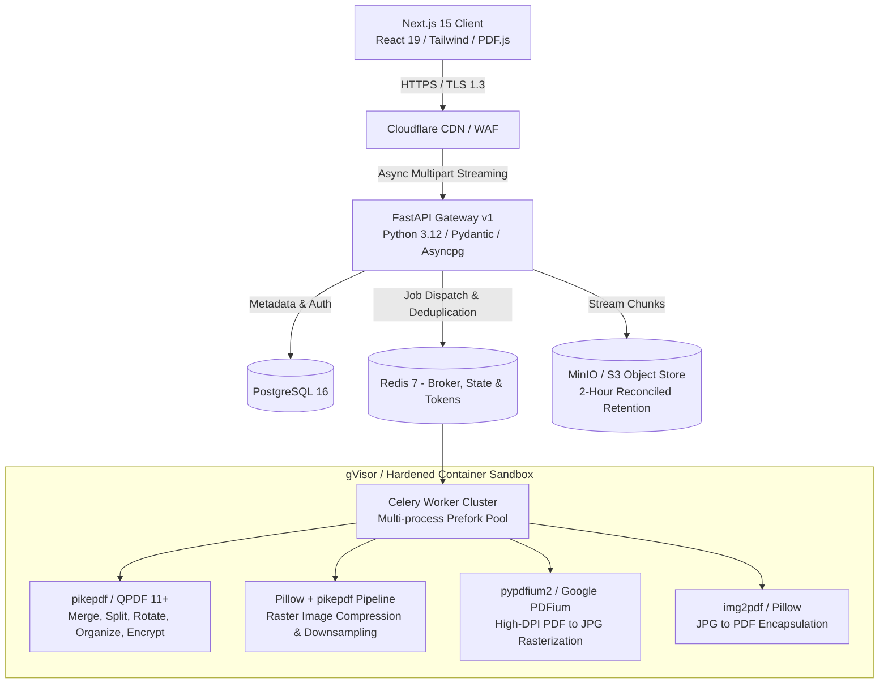

# Architecture Decision Record (ADR-001): PDF Platform Engine & Infrastructure Blueprint

**Status:** Approved in Principle (Final Revision 3 — Ready for Sign-Off)  
**Date:** November 2026  
**Document ID:** ADR-001  
**Project:** Independently Engineered PDF Processing Platform  
**Target Benchmark:** [iLovePDF (ilovepdf.com)](https://www.ilovepdf.com/)  
**Author:** Senior Product Analyst & Software Architect  
**Implementation Plan:** [`research/mvp-implementation-plan.md`](file:///e:/REA/research/mvp-implementation-plan.md)  
**Final Review & Entry Criteria:** [`research/final-architecture-review.md`](file:///e:/REA/research/final-architecture-review.md)  
**Audit Register:** [`research/evidence-register.md`](file:///e:/REA/research/evidence-register.md)  

---

## 1. Context & Architectural Problem Statement

Phase 1 established the functional baseline of 33 PDF tools, the 5-stage user workflow state machine, and the commercial freemium economics. To transition into Phase 2 (MVP Implementation) safely and sustainably, this document validates:
1. The exact processing engines for the 10 core MVP operations.
2. The compression architecture (separating structural optimization from raster image recompression with explicit color profile, transparency, mask handling, and a Sprint 2 Proof of Concept).
3. The dependency-level open-source licensing matrix and continuous automated SBOM verification.
4. The backend infrastructure architecture (Option B: FastAPI + Celery).
5. Operation-specific PDF sanitization that neutralizes active threats while preserving legitimate document features (hyperlinks, form fields, e-invoice attachments).
6. Operational robustness: Leased one-time download authorization with retry and chunked resume capabilities, multi-tier asynchronous data retention reconciliation, and reproducible benchmarks.

---

## 2. Decision Summary



* **Core Processing Stack:** **`QPDF 11+` (via `pikepdf`) + `Google PDFium` (via `pypdfium2`) + Custom `Pillow` Image Pipeline**.
* **Licensing Posture:** **100% Permissive / Weak Copyleft (Apache 2.0, BSD-3, MIT, MPL-2.0)**. Continuous automated SBOM auditing via Syft to prevent unauthorized copyleft/AGPL ingress.
* **Backend Framework:** **Option B: Next.js 15 (Frontend) + Python FastAPI + Celery + Redis + PostgreSQL + MinIO/S3**.
* **Security Model:** Sandboxed execution via container cgroups/gVisor, magic-byte validation, Flate bomb expansion monitoring, operation-specific parsing sanitization, and leased download token replay protection.

---

## 3. Section 1: Detailed Engine Validation (10 MVP Operations)

> [!NOTE]
> All CPU and memory figures below are **preliminary engineering estimates** based on micro-benchmarks on standard dual-core workers. Formal metrics will be established during Sprint 8 empirical load testing.

| Operation | Recommended Engine | Alternative Libraries | Capabilities & Mechanisms | Technical Limitations | Performance Profile | License | Maintenance & Activity | Preliminary Compute Estimates |
| :--- | :--- | :--- | :--- | :--- | :--- | :--- | :--- | :--- |
| **1. Merge PDF** | **`pikepdf` (`QPDF 11+`)** | `pdf-lib` (Node), `pypdf`, `MuPDF` (C) | Direct page tree concatenation, bookmark/outline merging, linearization. | Does not auto-normalize mismatched page dimensions. | C++ native execution; pointer copying without stream re-encoding. | **MPL-2.0** (`pikepdf`) + **Apache 2.0** (`libqpdf`) | Highly Active (v9.x released 2024–2026; upstream QPDF updated monthly). | **RAM:** ~20–60 MB est.<br/>**CPU:** <0.4s for 50 pages |
| **2. Split PDF** | **`pikepdf` (`QPDF 11+`)** | `pdf-lib`, `pypdf` | Page range extraction, bursting into single-page files, range merging. | Shared font/image resources must be deduplicated across slices to avoid bloat. | Direct object stream splicing; no transcoding overhead. | **MPL-2.0** + **Apache 2.0** | Highly Active | **RAM:** ~15–35 MB est.<br/>**CPU:** <0.2s for 20 pages |
| **3. Rotate PDF** | **`pikepdf` (`QPDF 11+`)** | `pdf-lib`, `pypdf` | Modifies page `/Rotate` dictionary attribute ($0^\circ, 90^\circ, 180^\circ, 270^\circ$). | Inherited rotation from parent `/Pages` tree must be resolved before writing. | Pure metadata dictionary update; instantaneous. | **MPL-2.0** + **Apache 2.0** | Highly Active | **RAM:** ~10–25 MB est.<br/>**CPU:** <0.05s per doc |
| **4. Reorder Pages** | **`pikepdf` (`QPDF 11+`)** | `pdf-lib` | Arbitrary page permutations and page shuffling. | Internal named destinations and outline links require destination re-indexing. | Re-indexes the `/Kids` array in the page tree; zero re-encoding. | **MPL-2.0** + **Apache 2.0** | Highly Active | **RAM:** ~15–40 MB est.<br/>**CPU:** <0.1s for 100 pages |
| **5. Remove Pages** | **`pikepdf` (`QPDF 11+`)** | `pdf-lib`, `pypdf` | Deletes selected page indices from the document tree. | Dangling orphaned resources must be pruned via object garbage collection. | `QPDF` automatic garbage collector strips unreachable streams during write. | **MPL-2.0** + **Apache 2.0** | Highly Active | **RAM:** ~15–40 MB est.<br/>**CPU:** <0.15s per file |
| **6. Compress PDF** | **Hybrid: `Pillow` (Raster Downsampling) + `QPDF` (Compaction)** | `Ghostscript` (AGPL), `MuPDF` (AGPL) | Re-encodes embedded JPEGs/PNGs at lower DPI/quality, removes private metadata, builds Object Streams (`/ObjStm`). | Requires a multi-pass pipeline (QPDF alone cannot downsample raster images). | Compute-bound during image resizing; disk I/O bound during object compaction. | **HPND/MIT** (`Pillow`) + **MPL/Apache** (`pikepdf`/`QPDF`) | Highly Active | **RAM:** ~100–350 MB est.<br/>**CPU:** 1.0–3.0s per file |
| **7. JPG to PDF** | **`img2pdf` / `Pillow`** | `pdf-lib`, `sharp` | Encapsulates JPEG/PNG images directly into PDF `/XObject` without re-encoding loss. | Transparency channels in PNGs require `/SMask` dictionary construction. | Lossless byte passthrough for JPEGs; near instantaneous. | **LGPL-3.0+** (`img2pdf`) or **HPND/MIT** (`Pillow`) | Highly Active | **RAM:** ~20–60 MB est.<br/>**CPU:** <0.2s per image |
| **8. PDF to JPG** | **`pypdfium2` (`Google PDFium`)** | `pdftoppm` (`Poppler`, GPL), `pdf2image` | Renders PDF pages to high-DPI raster images (150/300 DPI) with full font antialiasing. | Memory spikes on massive vector canvas layouts (e.g. CAD drawings). | Multi-threaded C++ rendering engine extracted from Chromium. | **BSD 3-Clause** (`PDFium`) + **Apache 2.0** (`pypdfium2`) | Highly Active (Chromium LTS updates). | **RAM:** ~60–200 MB est.<br/>**CPU:** ~0.3s per page |
| **9. Protect PDF** | **`pikepdf` (`QPDF 11+`)** | `pypdf` | Standard PDF encryption (AES-128, AES-256 / Revision 6), user/owner passwords, permission bits. | Passwords containing non-ASCII characters require SASLprep / UTF-8 normalization. | Hardware-accelerated AES stream encryption. | **MPL-2.0** + **Apache 2.0** | Highly Active | **RAM:** ~20–50 MB est.<br/>**CPU:** <0.3s for 10 MB |
| **10. Unlock PDF** | **`pikepdf` (`QPDF 11+`)** | `pypdf` | Decrypts stream payloads and clears owner restriction flags when password or master key is valid. | Cannot brute-force strong unknown AES-256 user passwords. | Symmetric key decryption of file byte stream. | **MPL-2.0** + **Apache 2.0** | Highly Active | **RAM:** ~20–50 MB est.<br/>**CPU:** <0.2s for 10 MB |

---

## 4. Section 2: In-Depth Compression Architecture & Technical Proof of Concept

### 4.1 Structural vs. Raster Compression
In real-world PDFs, **80% to 95% of total file size consists of embedded raster images**. QPDF handles structural compression (`/ObjStm`, `/XRef`, font deduplication, linearization), but treats raster image streams as opaque byte payloads and does not downsample them.

### 4.2 Safe Handling of PDF Image XObjects, Transparency & Color Profiles
`Pillow` is strictly an image-processing library (`PIL.Image`), not a PDF manipulation engine. It cannot interpret PDF dictionary inheritance, soft masks, or spot colors. The compression engine orchestrates `pikepdf` and `Pillow` via strict parsing rules:

1. **Extraction & Inspection (`pikepdf`):**
   * Traverse page `/Resources` dictionaries to locate `/XObject` entries where `/Subtype == /Image`.
   * Extract image metadata: `/Width`, `/Height`, `/BitsPerComponent`, `/ColorSpace`, and `/Filter`.
2. **Handling Transparency & Soft Masks (`/SMask`, `/Mask`):**
   * *Soft Mask (`/SMask`):* PDF transparency is maintained via an independent 8-bit grayscale image XObject referenced in `/SMask`. The pipeline extracts both the base RGB image and the `/SMask` grayscale stream. Both are resized using identical Lanczos dimensions. The base image is re-encoded as JPEG; the `/SMask` is re-encoded as FlateDecode grayscale. The `/SMask` reference is preserved.
   * *1-Bit Hard Mask (`/Mask`):* Stored as a 1-bit monochrome mask or color-key array (`/Mask [0 0 255 255]`). Color-key arrays are preserved verbatim without alteration.
3. **Handling Color Spaces & Color Profiles:**
   * *DeviceRGB:* Processed directly using sRGB profiles.
   * *DeviceCMYK & ICC Profiles:* In prepress documents, converting CMYK blindly to RGB causes severe color shifts. The pipeline checks `/ColorSpace`: if CMYK or an embedded `/ICCBased` profile is present, image operations preserve the CMYK channel layout or apply calibrated ICC profile transformations via `Pillow.ImageCms`.
   * *Separation & DeviceN (Spot Colors):* Images using spot color spaces are **bypassed** from lossy recompression and optimized only via lossless Flate stream recompression.
4. **Handling Unusual Encodings (JPEG2000, JBIG2):**
   * Images using `/JPXDecode` (JPEG2000) or `/JBIG2Decode` are inspected. If decompression libraries are absent or if lossy re-encoding would degrade text legibility in 1-bit scans, the stream is left untouched.
5. **Digitally Signed Documents (`/ByteRange`):**
   * Any document containing `/Contents` and `/ByteRange` in an AcroForm signature field will have its cryptographic hash invalidated by recompression. The engine detects signatures and **refuses recompression**, returning a client-safe alert: `"Document contains a cryptographic digital signature which would be invalidated by compression"`.
6. **Graceful Failure Degradation:**
   * If an individual `/XObject` fails Pillow decoding (e.g. exotic color space or corrupted stream), the pipeline logs a warning and leaves that specific stream **untouched**, continuing with other images and structural compaction. The job never crashes due to a single uncompressible image.

### 4.3 Sprint 2 Compression Proof of Concept (PoC Spike)
Before implementing the full Sprint 5 pipeline, a small technical PoC spike will be executed in Sprint 2 to validate:
* `/SMask` transparency alignment (no edge bleeding or black halos).
* CMYK and ICC profile fidelity.
* Handling of `/JPXDecode` (JPEG2000) and JBIG2 streams.
* Vector preservation in mixed vector/raster PDFs.
* Detection and safe rejection of digitally signed PDFs.
* Font glyph and AcroForm annotation preservation.

### 4.4 Reproducible Compression Benchmark Framework
We explicitly reject unverified marketing claims that custom pipelines "will match Ghostscript". In Sprint 5, the pipeline will be evaluated against a reproducible benchmark across a **100-document standardized corpus**:
* 25 Scanned Invoices / Contracts (Greyscale & monochrome raster).
* 25 Slide Decks & Presentations (Mixed vector and high-DPI photos).
* 25 Academic Research Papers (Vector text, charts, small raster figures).
* 25 High-Res Image Portfolios (Full-bleed photographic plates).
* **Metrics:** Compression Ratio ($\text{CR} = 1 - \frac{\text{size}_{\text{out}}}{\text{size}_{\text{in}}}$), Visual Distortion (SSIM and PSNR at 150 DPI), Throughput ($ms/\text{MB}$), and Peak Memory (RSS).

---

## 5. Section 3: Dependency SBOM & License Compliance Strategy

### 5.1 Dependency Matrix

| Component | Version | License | Category | Direct / Transitive | SaaS Compliance & Redistribution Conditions |
| :--- | :--- | :--- | :--- | :--- | :--- |
| **`Next.js`** | 15.x | **MIT** | Web Frontend | Direct | Include MIT copyright in client bundle. |
| **`React` / `ReactDOM`** | 19.x | **MIT** | Web Frontend | Direct | Include MIT copyright in client bundle. |
| **`PDF.js`** | 4.x | **Apache 2.0** | Web Frontend | Direct | Retain Apache NOTICE & copyright headers. Client-side rendering only. |
| **`Tailwind CSS`** | 4.x | **MIT** | Web Frontend | Direct | Standard permissive license. |
| **`FastAPI`** | 0.115+ | **MIT** | API Gateway | Direct | Permissive commercial use. |
| **`Starlette`** | 0.40+ | **BSD-3** | API Gateway | Transitive | Retain 3-clause BSD notice in documentation. |
| **`Pydantic`** | 2.10+ | **MIT** | Data Validation | Transitive | Permissive commercial use. |
| **`Uvicorn`** | 0.32+ | **BSD-3** | ASGI Server | Direct | Retain 3-clause BSD notice. |
| **`Celery`** | 5.4+ | **BSD-3** | Task Queue | Direct | Retain 3-clause BSD notice. |
| **`Redis-py`** | 5.2+ | **MIT** | Task Queue | Direct | Standard permissive license. |
| **`asyncpg`** | 0.30+ | **Apache 2.0** | Database | Direct | Include Apache NOTICE. |
| **`SQLAlchemy`** | 2.0+ | **MIT** | Database ORM | Direct | Permissive commercial use. |
| **`pikepdf`** | 9.x | **MPL-2.0** | PDF Engine | Direct | **Weak Copyleft:** If `pikepdf` C++/Python source files are unmodified, proprietary caller code is NOT affected. |
| **`libqpdf`** | 11.x | **Apache 2.0** | PDF Engine | Transitive (C++) | Changed from Artistic 2.0 to Apache 2.0 in QPDF 11. Retain Apache NOTICE. |
| **`pypdfium2`** | 4.x | **Apache 2.0 / BSD-3** | PDF Rendering | Direct | Dual licensed Python bindings. |
| **`Google PDFium`** | LTS | **BSD-3** | PDF Rendering | Transitive (C++) | Retain Chromium BSD-3 notice. |
| **`Pillow`** | 11.x | **HPND** | Image Engine | Direct | Historical permissive notice; retain copyright notice. |
| **`Debian 12 Slim`** | Bookworm | **Mixed (GPL/LGPL/MIT)**| Container Base | Base Image | Running GPL/LGPL utilities on an internal server triggers no conveyance obligations under copyright law. |

### 5.2 Automated SBOM & Continuous License Verification
* Every container build invokes `syft dir:. -o cyclonedx-json=sbom.json` to inventory direct, transitive, and OS-level packages.
* The CI pipeline checks licenses against a strict allowlist: `MIT`, `BSD-2-Clause`, `BSD-3-Clause`, `Apache-2.0`, `MPL-2.0`, `HPND`, `PSF-2.0`, `ISC`.
* Any dependency carrying `AGPL-1.0`, `AGPL-3.0`, `SSPL`, or `EUPL` automatically breaks the CI build.

---

## 6. Section 4: Architecture Decision (Option B)

### Recommendation: Option B (Next.js 15 + Python FastAPI + Celery + Redis + PostgreSQL + MinIO/S3)
* **Unified Language Stack:** 100% Python 3.12 across API gateway, data models, task queues, and worker libraries.
* **Zero Schema Drift:** Identical Pydantic models validate incoming HTTP requests, serialize Celery task arguments, and map database entities.
* **Native Async Streaming:** FastAPI built on Starlette/Uvicorn natively streams multipart chunks directly to MinIO/S3 using `aioboto3` without buffering files in RAM.
* **Direct Library Integration:** Fast pre-flight PDF checks (page counts, password verification) execute synchronously in the API layer using `pikepdf` without dispatching background queue tasks.

---

## 7. Section 5: Security Architecture & Operation-Specific Sanitization

### 7.1 Operation-Specific Sanitization Matrix
Blanket stripping of PDF attributes breaks legitimate documents. The platform enforces operation-specific rules:

| Operation | `/URI` (Hyperlinks) | `/OpenAction` (Initial View) | `/AA` (Additional Actions) | `/Launch` (OS Executable) | `/JavaScript` & `/JS` | `/EmbeddedFiles` (Attachments) |
| :--- | :--- | :--- | :--- | :--- | :--- | :--- |
| **Merge / Split / Organize / Rotate** | **PRESERVE** | **PRESERVE** if valid `/Fit` destination array; **STRIP** if script-based. | **STRIP** mouse-enter/page-open triggers; **PRESERVE** field format validations. | **ALWAYS STRIP** | **STRIP** active scripts. | **PRESERVE** data attachments (`.xml`, `.csv`, e-invoices); **STRIP** executable extensions (`.exe`, `.bat`, `.vbs`, `.js`). |
| **Compress PDF** | **PRESERVE** | **PRESERVE** | **PRESERVE** | **ALWAYS STRIP** | **PRESERVE** | **PRESERVE** data formats; recompress stream if Flate-encoded. |
| **Protect / Unlock** | **PRESERVE** | **PRESERVE** | **PRESERVE** | **ALWAYS STRIP** | **PRESERVE** | **PRESERVE** |
| **PDF to JPG** | N/A (Rasterized) | N/A | N/A | Ignored by renderer | Disabled in PDFium | Ignored by renderer |

### 7.2 Flate Decompression Bomb Protection
Workers monitor uncompressed byte expansion in real time. If a stream exceeds a **50:1 expansion ratio** or a **200 MB uncompressed ceiling**, the worker terminates processing immediately with `malformed_stream`.

### 7.3 Hardened Worker Sandboxing
* Unprivileged non-root user (`uid=10001:10001`).
* Read-only root filesystem (`--read-only`). Local scratch directory is a private RAM-backed tmpfs (`/tmp/pdf_jobs/{job_id}`, `size=256m`, `noexec`, `nosuid`).
* All Linux capabilities dropped (`--cap-drop=ALL`). Flag `--security-opt=no-new-privileges` enforced.
* `gVisor` (`runsc`) user-space kernel isolation between workers and host OS.
* Cgroups resource ceilings: `memory: 512m`, `cpus: 1.0`. Hard supervisor deadline: 60-second SIGKILL timeout.

---

## 8. Section 6: Reliable Leased Download-Token Flow

### 8.1 The Failure Mode of Immediate Token Invalidation (`GETDEL`)
If a single-use token is deleted from Redis immediately upon the initial HTTP GET request, any transient failure—such as an S3 streaming disconnect, a network timeout, or a client TCP drop—causes permanent data loss for the user. Furthermore, modern browsers emit multiple HTTP requests with `Range: bytes=...` headers to support chunked streaming and download managers. Immediate deletion breaks chunked recovery.

### 8.2 Reliable Leased Authorization Architecture

```mermaid
stateDiagram-v2
    [*] --> ISSUED: Job completes; POST /download-token
    
    state ISSUED {
        [*] --> WaitingForFirstDownload: 15-Minute Base Lifetime
    }
    
    ISSUED --> LEASED: Client sends first GET request
    
    state LEASED {
        [*] --> StreamingBytes: 120-Second Grace Lease Activated
        StreamingBytes --> BoundedRetries: Allows up to 3 retry attempts & HTTP Range chunks
    }
    
    LEASED --> COMPLETED: Transfer finishes successfully
    LEASED --> EXPIRED: 120s grace expires OR max retries reached
    ISSUED --> EXPIRED: 15m lifetime expires without download
    
    COMPLETED --> [*]
    EXPIRED --> [*]
```

1. **Token Issuance:** When a job completes, `POST /api/v1/jobs/{job_id}/download-token` generates a cryptographically secure 256-bit token (`secrets.token_urlsafe(32)`).
2. **State & Metadata in Redis:** Stored as a Redis Hash at `download_token:{token}`:
   ```json
   {
     "job_id": "uuid",
     "artifact_s3_key": "artifacts/.../merged.pdf",
     "state": "ISSUED",
     "created_at": 1731412800,
     "base_expires_at": 1731413700,
     "first_redeemed_at": null,
     "lease_expires_at": null,
     "download_attempts": 0,
     "max_attempts": 3,
     "client_ip_hash": "sha256(ip + salt)"
   }
   ```
3. **Atomic Redemption & Lease Activation (Lua Script):**
   * When `GET /api/v1/downloads/{token}` is called, an atomic Redis Lua script executes:
     * Check if token exists and `now < base_expires_at`.
     * Check if `state == 'ISSUED'`: transition to `LEASED`, increment `download_attempts = 1`, record `first_redeemed_at = now`, and set a **120-second lease window** (`lease_expires_at = now + 120`).
     * If `state == 'LEASED'`: check if `now < lease_expires_at` and `download_attempts < max_attempts`. Increment `download_attempts`.
     * If attempts exceed 3 or lease has expired: return `NIL` (reject).
4. **Storage Failure & Client Recoverability:**
   * If S3 returns an error (e.g. 500/503) before streaming begins, the API decrements `download_attempts` and rolls back state.
   * If the client connection drops mid-stream, the client can reconnect within the 120-second lease window using standard HTTP `Range` headers to resume the download.
5. **Replay Protection Guarantee:** Once the 120-second lease expires or the download completes, the token is permanently evicted from Redis. Replay attempts outside this window receive **HTTP 410 Gone**.

---

## 9. Section 7: Reconciled Data Retention Policy & Audit Guarantees

### 9.1 The Reality of Asynchronous Deletion
Asynchronous S3 bucket lifecycle rules run as background batch jobs and do **not** provide exact-minute guarantees. The platform defines its retention policy as a **reconciled target with documented maximum delays**:

* **Retention Start Timestamp ($T_0$):** The exact moment a job transitions to a terminal state (`COMPLETED` or `FAILED`). For abandoned staging uploads, $T_0$ is the staging upload timestamp.
* **Target Retention Window:** 120 minutes ($T_0 + 120\text{m}$).
* **Maximum Expected Cleanup Delay:** Celery Beat runs every 10 minutes. Under normal conditions, cleanup occurs between $120\text{m}$ and $130\text{m}$. The maximum expected cleanup delay under transient worker load is **$T_0 + 135\text{ minutes}$**.

### 9.2 Three-Tier Deletion Architecture
1. **Tier 1 (Synchronous Worker Cleanup):** Every worker task wraps execution in a `try...finally` block that unlinks local input/output files and purges `/tmp/pdf_jobs/{job_id}` immediately upon completion or failure.
2. **Tier 2 (Active 10-Minute Sweeper):** A Celery Beat task runs every 10 minutes. It queries PostgreSQL for jobs where `status IN ('COMPLETED', 'FAILED') AND completed_at < NOW() - INTERVAL '2 hours' AND purged_at IS NULL`.
   * Issues explicit S3 batch `DeleteObjects` calls against raw and artifact buckets.
   * Issues `AbortMultipartUpload` for incomplete uploads older than 2 hours.
   * Updates PostgreSQL: `UPDATE jobs SET purged_at = NOW(), purge_verified = TRUE`.
3. **Tier 3 (Infrastructure Failsafe):** MinIO/S3 bucket lifecycle rules enforce a 24-hour expiration rule and an `AbortIncompleteMultipartUpload: DaysAfterInitiation: 1` rule. Object versioning is explicitly **disabled** on ephemeral processing buckets.

### 9.3 Cleanup Failure Retries & Audit Records
* If S3 `DeleteObjects` fails (e.g. storage outage), the sweeper retries with exponential backoff (1m, 5m, 15m).
* If deletion fails after 3 retries, the job is flagged `PURGE_FAILED` in PostgreSQL, generating an automated SRE alert.
* S3 files are deleted, but anonymized audit records (job ID, operation type, byte sizes, processing duration, purge timestamp) are retained in PostgreSQL for operational telemetry and SLA compliance.

---

## 10. Document Status

This Architecture Decision Record establishes the verified technical design for the MVP. Implementation details, test specifications, and sprint roadmaps are finalized in [`research/mvp-implementation-plan.md`](file:///e:/REA/research/mvp-implementation-plan.md) and [`research/final-architecture-review.md`](file:///e:/REA/research/final-architecture-review.md).

*Approved in Principle — Ready for Sprint 1 initiation upon formal sign-off.*
