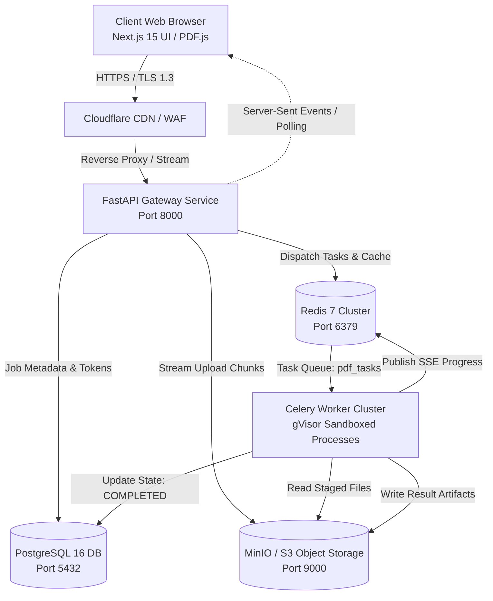
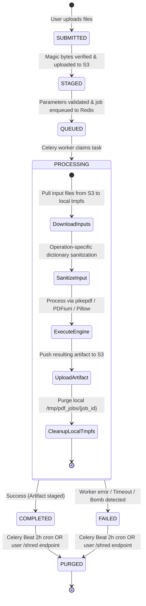
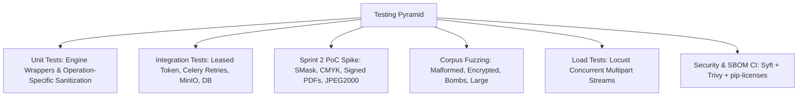

# MVP Implementation Plan: Independently Engineered PDF Platform

**Document Type:** Detailed Engineering Specification & Phased Execution Roadmap  
**Status:** Approved for Implementation — Phase 2 Ready  
**Architecture Reference:** [`research/architecture-decision-record.md` (ADR-001 Revision 3)](file:///e:/REA/research/architecture-decision-record.md)  
**Final Review & Entry Criteria:** [`research/final-architecture-review.md`](file:///e:/REA/research/final-architecture-review.md)  
**Audit Register:** [`research/evidence-register.md`](file:///e:/REA/research/evidence-register.md)  
**Date:** November 2026  
**Audience:** Software Engineers, DevOps / SRE, Product Architects  

---

## 1. Executive Summary

This document translates the architectural decisions ratified in **ADR-001 (Revision 3)** into an actionable, sprint-by-sprint implementation plan. It defines the monorepo codebase structure, microservice boundaries, OpenAPI v1 specification, relational PostgreSQL schemas, job lifecycle state machines, security sandboxing configurations, test corpus specifications, and an 8-sprint delivery roadmap.

**Scope of MVP (10 Tools):**
1. Merge PDF
2. Split PDF
3. Rotate PDF
4. Reorder Pages (Organize)
5. Remove Pages
6. Compress PDF (Dual-pass structural + image downsampling)
7. JPG to PDF
8. PDF to JPG (150/300 DPI rasterization)
9. Protect PDF (AES-256 encryption)
10. Unlock PDF (Password removal & permission decryption)

---

## 2. Repository Structure (Monorepo Blueprint)

The codebase uses a clean, unified monorepo managed with `pnpm` (for the frontend workspace) and Python standard packaging (`uv` / `pyproject.toml`):

```
pdf-platform/
├── .github/
│   └── workflows/
│       ├── ci.yml                 # Lint, test, Syft SBOM generation, license verification
│       └── release.yml            # Docker build, Trivy scan, deployment
├── apps/
│   ├── web/                       # Next.js 15 Frontend
│   │   ├── src/
│   │   │   ├── app/               # App Router pages (/merge, /compress, etc.)
│   │   │   ├── components/        # UI component library (Dropzone, Canvas, Staging)
│   │   │   ├── hooks/             # Custom React hooks (useFileUpload, useJobStatus)
│   │   │   └── lib/               # Client utilities (PDF.js worker wrapper, API client)
│   │   ├── public/                # Static brand assets, favicon, PDF.js WASM binaries
│   │   ├── package.json
│   │   └── tailwind.config.ts
│   │
│   ├── api/                       # Python FastAPI Backend Gateway
│   │   ├── src/
│   │   │   ├── api/
│   │   │   │   └── v1/            # API v1 routes (/jobs, /downloads, /health)
│   │   │   ├── core/              # Config, security, logging, telemetry
│   │   │   ├── db/                # SQLAlchemy ORM models & Asyncpg session
│   │   │   ├── schemas/           # Pydantic v2 request/response models
│   │   │   ├── services/          # S3 storage service, leased token service, job service
│   │   │   └── main.py            # FastAPI ASGI app entry point
│   │   ├── pyproject.toml
│   │   └── Dockerfile
│   │
│   └── worker/                    # Celery Background Processing Cluster
│       ├── src/
│       │   ├── tasks/             # Celery tasks (merge, split, compress, render)
│       │   ├── engines/           # Core PDF processing wrappers
│       │   │   ├── qpdf_engine.py      # pikepdf / QPDF structural wrapper
│       │   │   ├── pdfium_engine.py    # pypdfium2 high-DPI rasterizer
│       │   │   ├── image_pipeline.py   # Pillow raster downsampling & color profiles
│       │   │   ├── sanitization.py     # Operation-specific PDF sanitization
│       │   │   └── security_engine.py  # AES-256 encryption/decryption
│       │   ├── celery_app.py      # Celery instance config & Beat schedule
│       │   └── worker.py          # Celery worker runner
│       ├── pyproject.toml
│       └── Dockerfile
│
├── packages/
│   └── shared-types/              # JSON Schema / OpenAPI generated TypeScript types
│
├── infra/
│   ├── docker/
│   │   ├── docker-compose.yml     # Local dev: Web, API, Worker, Redis, Postgres, MinIO
│   │   └── docker-compose.prod.yml
│   ├── k8s/                       # Kubernetes manifests (deployments, ingress, cgroups)
│   └── scripts/
│       ├── setup-dev.sh
│       └── generate-sbom.sh       # Syft CycloneDX SBOM generation script
│
└── tests/
    ├── corpus/                    # Standardized test document testbed
    │   ├── encrypted/
    │   ├── malformed/
    │   ├── scanned/
    │   ├── transparency/
    │   ├── fonts/
    │   ├── large/
    │   └── security_probes/
    ├── integration/               # End-to-end API & worker integration tests
    └── load/                      # Locust load test scripts
```

---

## 3. Service Boundaries & System Architecture



---

## 4. REST API Specification (OpenAPI v1)

All endpoints are strictly scoped under `/api/v1/`.

| Method | Endpoint Path | Request Payload | Response Payload | Description | Auth / Rate Limit |
| :--- | :--- | :--- | :--- | :--- | :--- |
| `POST` | `/api/v1/files/upload` | `multipart/form-data` (`file`) | `201 Created`<br/>`{ "file_id": "uuid", "filename": "doc.pdf", "byte_size": 1024, "page_count": 5 }` | Streams upload directly to S3; validates magic bytes; extracts preliminary metadata. | Anonymous; 10 req/min/IP |
| `POST` | `/api/v1/jobs` | `application/json`<br/>`{ "operation": "merge", "file_ids": ["id1", "id2"], "parameters": {} }` | `202 Accepted`<br/>`{ "job_id": "uuid", "status": "QUEUED", "created_at": "ISO" }` | Enqueues background worker job. Accepts optional `Idempotency-Key` header. | Anonymous; 20 req/min/IP |
| `GET` | `/api/v1/jobs/{job_id}` | None | `200 OK`<br/>`{ "job_id": "uuid", "status": "PROCESSING", "progress_pct": 65, "error": null }` | Returns real-time status, progress percentage, or failure error code. | Anonymous; 60 req/min/IP |
| `GET` | `/api/v1/jobs/{job_id}/events` | None (HTTP SSE) | `text/event-stream`<br/>`data: { "status": "PROCESSING", "progress": 75 }` | Server-Sent Events stream for instant progress updates without polling. | Anonymous |
| `POST` | `/api/v1/jobs/{job_id}/download-token`| None | `200 OK`<br/>`{ "download_token": "hex256", "expires_in": 900 }` | Issues a leased, 15-minute token with a 120-second download lease window. | Anonymous; 10 req/min/IP |
| `GET` | `/api/v1/downloads/{token}` | None (Accepts `Range: bytes=...`) | `200 OK` or `206 Partial Content`<br/>`Content-Disposition: attachment; filename="result.pdf"` | Streams output file. Activates 120-second lease window; supports retries and resume. | Token-authenticated |
| `DELETE` | `/api/v1/jobs/{job_id}/shred` | None | `204 No Content` | User-initiated instant shredder: immediately purges S3 objects and local scratch files. | Anonymous (matching creator IP/session) |
| `GET` | `/api/v1/health` | None | `200 OK`<br/>`{ "status": "healthy", "redis": "ok", "postgres": "ok", "s3": "ok" }` | Health check probe for Kubernetes liveness/readiness probes. | Public |

---

## 5. Database Entities & Relational Schema (PostgreSQL)

```sql
CREATE EXTENSION IF NOT EXISTS "uuid-ossp";

CREATE TYPE job_status AS ENUM (
    'SUBMITTED', 'STAGED', 'QUEUED', 'PROCESSING', 'COMPLETED', 'FAILED', 'PURGED'
);

CREATE TABLE jobs (
    id UUID PRIMARY KEY DEFAULT uuid_generate_v4(),
    idempotency_key VARCHAR(64) UNIQUE,
    operation VARCHAR(32) NOT NULL,
    status job_status NOT NULL DEFAULT 'SUBMITTED',
    parameters JSONB NOT NULL DEFAULT '{}'::jsonb,
    client_ip_hash VARCHAR(64) NOT NULL,
    created_at TIMESTAMPTZ NOT NULL DEFAULT NOW(),
    started_at TIMESTAMPTZ,
    completed_at TIMESTAMPTZ,
    purged_at TIMESTAMPTZ,
    purge_verified BOOLEAN NOT NULL DEFAULT FALSE,
    error_code VARCHAR(64),
    error_detail TEXT
);

CREATE INDEX idx_jobs_status_created ON jobs(status, created_at);
CREATE INDEX idx_jobs_purged ON jobs(purged_at) WHERE purged_at IS NULL;
CREATE INDEX idx_jobs_idempotency ON jobs(idempotency_key) WHERE idempotency_key IS NOT NULL;

CREATE TABLE job_files (
    id UUID PRIMARY KEY DEFAULT uuid_generate_v4(),
    job_id UUID NOT NULL REFERENCES jobs(id) ON DELETE CASCADE,
    s3_key VARCHAR(255) NOT NULL,
    original_filename VARCHAR(255) NOT NULL,
    byte_size BIGINT NOT NULL,
    page_count INT,
    sort_order INT NOT NULL DEFAULT 0,
    created_at TIMESTAMPTZ NOT NULL DEFAULT NOW()
);

CREATE INDEX idx_job_files_job_id ON job_files(job_id);

CREATE TABLE job_artifacts (
    id UUID PRIMARY KEY DEFAULT uuid_generate_v4(),
    job_id UUID UNIQUE NOT NULL REFERENCES jobs(id) ON DELETE CASCADE,
    s3_key VARCHAR(255) NOT NULL,
    output_filename VARCHAR(255) NOT NULL,
    byte_size BIGINT NOT NULL,
    mime_type VARCHAR(64) NOT NULL DEFAULT 'application/pdf',
    page_count INT,
    created_at TIMESTAMPTZ NOT NULL DEFAULT NOW()
);

CREATE TABLE download_tokens (
    token_hash VARCHAR(64) PRIMARY KEY,
    job_id UUID NOT NULL REFERENCES jobs(id) ON DELETE CASCADE,
    base_expires_at TIMESTAMPTZ NOT NULL,
    lease_expires_at TIMESTAMPTZ,
    download_attempts INT NOT NULL DEFAULT 0,
    max_attempts INT NOT NULL DEFAULT 3,
    client_ip_hash VARCHAR(64) NOT NULL
);

CREATE INDEX idx_download_tokens_lookup ON download_tokens(token_hash, lease_expires_at);
```

---

## 6. Processing Job Lifecycle State Machine



---

## 7. Concrete Security & Sandboxing Configuration

### 7.1 Hardened Worker Container Specification (`apps/worker/Dockerfile`)

```dockerfile
# Multi-stage hardened worker build
FROM python:3.12-slim-bookworm AS builder

RUN apt-get update && apt-get install -y --no-install-recommends \
    build-essential \
    libqpdf-dev \
    && rm -rf /var/lib/apt/lists/*

WORKDIR /app
COPY pyproject.toml .
RUN pip install --no-cache-dir .

# Production runtime stage
FROM python:3.12-slim-bookworm

RUN apt-get update && apt-get install -y --no-install-recommends \
    libqpdf29 \
    && rm -rf /var/lib/apt/lists/*

# Security: Create unprivileged user with fixed UID/GID
RUN groupadd -g 10001 appgroup && \
    useradd -u 10001 -g appgroup -s /sbin/nologin -M appuser

WORKDIR /app
COPY --from=builder /usr/local/lib/python3.12/site-packages /usr/local/lib/python3.12/site-packages
COPY src/ ./src/

USER 10001:10001

ENTRYPOINT ["celery", "-A", "src.celery_app", "worker", "--loglevel=info", "--concurrency=4"]
```

### 7.2 Docker Compose Worker Security Constraints (`infra/docker/docker-compose.yml`)

```yaml
  pdf-worker:
    build:
      context: ../../apps/worker
    user: "10001:10001"
    read_only: true
    security_opt:
      - no-new-privileges:true
    cap_drop:
      - ALL
    tmpfs:
      - /tmp/pdf_jobs:size=256M,mode=1777,noexec,nosuid,nodev
    deploy:
      resources:
        limits:
          cpus: '1.0'
          memory: 512M
    environment:
      - REDIS_URL=redis://redis:6379/0
      - S3_ENDPOINT=http://minio:9000
```

---

## 8. Comprehensive Testing Strategy

### 8.1 Testing Layers



1. **Unit Testing (`pytest`):**
   * Coverage $> 85\%$ across all engine wrappers (`qpdf_engine.py`, `pdfium_engine.py`, `image_pipeline.py`, `sanitization.py`).
   * Tests for operation-specific sanitization: assert `/URI` hyperlinks are preserved in Merge/Compress; assert `/Launch` is stripped; assert data attachments are retained while `.exe` is removed.
2. **Integration Testing (`testcontainers-python`):**
   * Spins up real MinIO, PostgreSQL, and Redis containers in Docker for end-to-end job verification.
   * Asserts leased token redemption, 120-second recovery window, chunked HTTP `Range` download resumes, and 410 Gone rejection on replay.
   * Asserts Celery `acks_late=True` task idempotency and DLQ routing.
3. **Sprint 2 Compression Proof of Concept Spike:**
   * Validates `/SMask` transparency, CMYK/ICC profiles, `/JPXDecode` (JPEG2000), JBIG2, and vector preservation.
   * Validates that digitally signed PDFs are detected and safely rejected from lossy compression.
4. **Test Corpus Fuzzing (`tests/corpus/`):**
   * *Encrypted:* Asserts proper handling of user/owner passwords and clean error return on incorrect passwords.
   * *Malformed:* Ingests broken xrefs, missing trailers, truncated EOFs; asserts graceful recovery or standard error.
   * *Decompression Bombs:* Ingests synthetic Flate bombs; asserts worker halts before memory exhaustion without crashing.
   * *Large Documents:* Ingests 100 MB+ files and 1,000-page filings.
5. **Performance & Load Testing (`Locust`):**
   * Target: 50 concurrent multipart uploads of 15 MB PDFs while maintaining API response latency $< 250\text{ ms}$ and job queue latency $< 3.0\text{ s}$.

---

## 9. Phased 8-Sprint Implementation Sequence

```
Sprint 1: Infrastructure, Monorepo Scaffolding & CI SBOM Gates
Sprint 2: QPDF Structural Engine & Compression PoC Spike
Sprint 3: Security Hardening, Operation-Specific Sanitization & Encryption
Sprint 4: High-DPI Image Conversions (PDFium & img2pdf)
Sprint 5: Dual-Pass Compression Pipeline & 100-Doc Benchmark
Sprint 6: Next.js 15 Staging Workspace (PDF.js Canvas Previews, Drag-and-Drop)
Sprint 7: Download Hub, Leased Token Replay Protection & Reconciled 2h Sweeper
Sprint 8: Full Corpus Fuzzing, Empirical Load Benchmarks, SBOM Audit & Sign-Off
```

### Detailed Sprint Breakdown

#### Sprint 1: Infrastructure, Monorepo Scaffolding & CI
* **Objectives:** Establish development environment, database migrations, message broker, and CI pipelines.
* **Tasks:**
  * Initialize monorepo layout (`apps/web`, `apps/api`, `apps/worker`).
  * Configure Docker Compose dev stack (FastAPI, Celery, Redis, PostgreSQL 16, MinIO).
  * Configure Alembic database migrations and apply initial schema DDL.
  * Implement automated GitHub Actions CI with Syft SBOM generation and license compliance scanning (`pip-licenses`, `trivy`).
* **Exit Criteria:** `docker compose up` starts all services healthy; CI passes SBOM check.

#### Sprint 2: Core QPDF Structural Engine & Compression PoC Spike
* **Objectives:** Implement the first 5 structural PDF tools and execute the technical compression PoC spike.
* **Tasks:**
  * Implement `QPDFEngine` wrapping `pikepdf` for Merge, Split, Rotate, Remove, and Organize.
  * Write Celery task handlers for structural jobs.
  * Implement file upload API with streaming chunking to MinIO.
  * **Compression PoC Spike:** Test `pikepdf` + `Pillow` on `/SMask` transparency, CMYK/ICC profiles, signed PDFs, and JPEG2000. Document edge-case behaviors.
* **Exit Criteria:** Can merge 10 PDFs with sub-second execution; compression PoC spike passes all 6 test cases.

#### Sprint 3: Security Engine & Operation-Specific Sanitization
* **Objectives:** Implement encryption operations, operation-specific sanitization, and enforce sandbox boundaries.
* **Tasks:**
  * Implement `Protect PDF` (AES-256 R=6 encryption) and `Unlock PDF` (password decryption).
  * Implement operation-specific sanitization matrix in `sanitization.py`.
  * Enforce magic-byte validation (`%PDF-`) and file size limits in FastAPI middleware.
  * Implement Flate bomb byte expansion monitor in stream reader.
  * Configure worker non-root container sandbox, cgroups (`memory=512m`), and read-only root.
* **Exit Criteria:** Worker terminates synthetic Flate bombs safely; hyperlinks and e-invoice data attachments are preserved while `/Launch` and active scripts are neutralized.

#### Sprint 4: High-DPI Image Conversions
* **Objectives:** Implement bidirectional image/PDF conversions.
* **Tasks:**
  * Implement `PDF to JPG` using `pypdfium2` at 150 DPI and 300 DPI with anti-aliasing.
  * Implement `JPG to PDF` using `img2pdf` for lossless passthrough and `Pillow` for PNG transparency handling.
  * Handle multi-page raster exports packaged into `.zip` archives.
* **Exit Criteria:** 20-page document converted to crisp JPGs in $<6\text{ seconds}$.

#### Sprint 5: Dual-Pass Compression Pipeline & Benchmark
* **Objectives:** Implement production raster image downsampling and structural compaction.
* **Tasks:**
  * Implement production `ImagePipeline` to extract `/XObject` images, handle `/SMask` transparency, and downsample using Lanczos filtering.
  * Implement structural compaction pass via `pikepdf` (object streams, font deduplication, linearization).
  * Build the three presets: Extreme (72 DPI, Q=55), Recommended (144 DPI, Q=75), Less (200 DPI, Q=88).
  * Execute reproducible benchmark against the 100-document test corpus.
* **Exit Criteria:** Benchmark demonstrates verifiable file size reduction without corrupting vector text, spot colors, or signed documents.

#### Sprint 6: Next.js 15 Web Workspace
* **Objectives:** Build responsive, zero-friction client-side staging interface.
* **Tasks:**
  * Scaffold Next.js 15 App Router pages matching verified information architecture.
  * Implement client-side thumbnail rendering using Mozilla `PDF.js` via Web Workers.
  * Implement drag-and-drop file reordering staging canvas.
  * Build dynamic right-hand configuration sidebar and responsive mobile drawer.
* **Exit Criteria:** User can drop files, reorder pages visually with zero network lag, and configure parameters.

#### Sprint 7: Download Hub, Leased Token Replay Protection & Retention Reconciler
* **Objectives:** Build completion screen, leased token authorization with chunked resume, and multi-tier retention reconciliation.
* **Tasks:**
  * Implement leased download token generation and atomic Redis Lua redemption with 120-second recovery lease.
  * Implement streaming endpoint supporting HTTP `Range` requests for interrupted download resumption.
  * Build UI download hub: auto-download trigger, QR code generator, and manual trash shredder button.
  * Configure Celery Beat 10-minute cleanup sweeper and S3 lifecycle rule backstop.
* **Exit Criteria:** Token cannot be replayed after lease expiration; client can resume interrupted downloads; expired files are verifiably purged.

#### Sprint 8: Full Corpus Fuzzing, Empirical Load Benchmarks & Sign-Off
* **Objectives:** Execute end-to-end stress testing, corpus fuzzing, and final audits.
* **Tasks:**
  * Run complete test corpus through all 10 tools.
  * Execute Locust load tests under 50 concurrent multipart streaming users.
  * Measure empirical CPU and RAM usage across worker nodes to replace preliminary estimates.
  * Run final Syft SBOM audit and Trivy container vulnerability scan.
* **Exit Criteria:** Zero unresolved security CVEs, zero AGPL violations, $>99.5\%$ success rate under load.

---

## 10. Document Status

This Implementation Plan is complete, robust, and fully synchronized with **ADR-001 (Revision 3)**. All engineering prerequisites for Phase 2 development have been satisfied.

*Ready for Sprint 1 initiation upon formal sign-off.*
