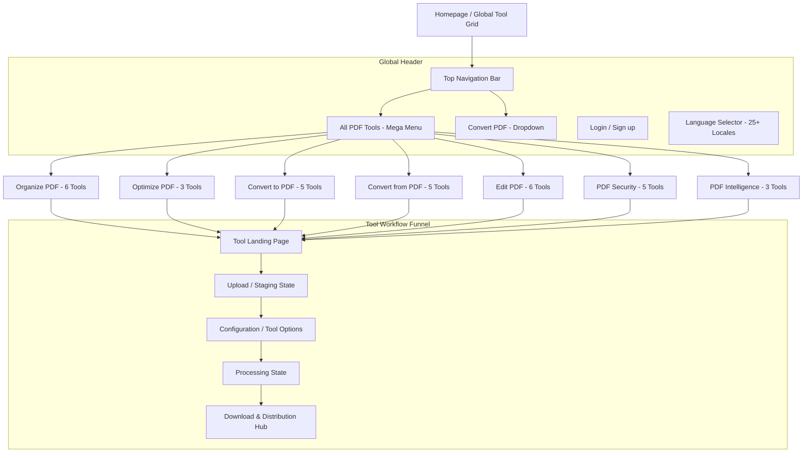
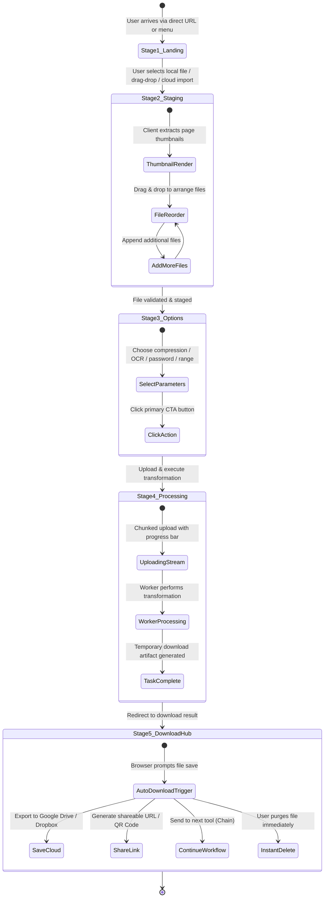

# Navigation Map & Information Architecture: iLovePDF Reference Analysis

**Document Type:** Information Architecture (IA) Specification & User Flow State Machine  
**Status:** Phase 1 — Iteration 2 (Evidence-Verified & Audited)  
**Reference Target:** [iLovePDF (ilovepdf.com)](https://www.ilovepdf.com/)  
**Audit Register:** [`research/evidence-register.md`](file:///e:/REA/research/evidence-register.md)  
**Inspection Evidence:** [`ilovepdf_home_screenshot.png`](file:///e:/REA/research/ilovepdf_home_screenshot.png), [`ilovepdf_merge_screenshot.png`](file:///e:/REA/research/ilovepdf_merge_screenshot.png), [`ilovepdf_mobile_screenshot.png`](file:///e:/REA/research/ilovepdf_mobile_screenshot.png)  

---

## 1. Verified Information Architecture & Hierarchy

Direct REA browser inspection of the live DOM and accessibility tree confirms that the platform structure is designed around programmatic, high-intent tool landing pages:



---

## 2. Verified Navigation Structures

### 2.1 Header Navigation Structure (Desktop)
Inspected live via Chrome CDP on `https://www.ilovepdf.com/`:
* **Brand Logo:** `link "iLovePDF"` -> `/`
* **High-Priority Direct Nav Items:**
  * `link "Merge PDF"` -> `/merge_pdf`
  * `link "Split PDF"` -> `/split_pdf`
  * `link "Compress PDF"` -> `/compress_pdf`
  * `listitem: Convert PDF` (Dropdown selector)
* **Comprehensive Drawer:** `listitem: All PDF tools` (Expands multi-column category drawer)
* **Account Controls:**
  * `link "Login"` -> `/login`
  * `link "Sign up"` -> `/register`
* **Mobile Breakpoint Behavior:** At `< 640px` (verified via mobile viewport `390x844`), desktop links collapse into a clean top-left brand logo and a top-right hamburger menu icon.

### 2.2 Category Hierarchy & Dedicated Tool Routes

```
[ Verified 7-Category Navigation Structure ]
├── 1. Organize PDF
│   ├── /merge_pdf
│   ├── /split_pdf
│   ├── /remove-pages
│   ├── /extract-pages
│   ├── /organize-pdf
│   └── /scan-pdf
├── 2. Optimize PDF
│   ├── /compress_pdf
│   ├── /repair-pdf
│   └── /ocr-pdf
├── 3. Convert to PDF
│   ├── /jpg_to_pdf
│   ├── /word_to_pdf
│   ├── /powerpoint_to_pdf
│   ├── /excel_to_pdf
│   └── /html-to-pdf
├── 4. Convert from PDF
│   ├── /pdf_to_jpg
│   ├── /pdf_to_word
│   ├── /pdf_to_powerpoint
│   ├── /pdf_to_excel
│   └── /convert-pdf-to-pdfa
├── 5. Edit PDF
│   ├── /rotate_pdf
│   ├── /add_pdf_page_number
│   ├── /pdf_add_watermark
│   ├── /crop-pdf
│   ├── /edit-pdf
│   └── /pdf-forms
├── 6. PDF Security
│   ├── /unlock_pdf
│   ├── /protect-pdf
│   ├── /sign-pdf
│   ├── /redact-pdf
│   └── /compare-pdf
└── 7. PDF Intelligence
    ├── /pdf-summarize
    ├── /translate-pdf
    └── /pdf-to-markdown
```

---

## 3. Tool Workflow State Machine

Inspected live on `/merge_pdf` and `/compress_pdf`:



### Verified Stage Interactions

1. **Stage 1 (Hero Dropzone):**
   * Prominent crimson CTA button (`link "Select PDF files"` / `button "Choose File"`).
   * Secondary cloud import icons (Google Drive & Dropbox) adjacent to the main CTA.
   * Text cue: `"or drop PDFs here"`. Full viewport drag-and-drop listener.
2. **Stage 2 (Staging Canvas):**
   * Multi-file thumbnail grid with client-rendered preview cards.
   * Drag-and-drop card reordering; contextual rotation ($90^\circ$) and deletion buttons on hover.
3. **Stage 3 (Options Sidebar):**
   * Right-docked configuration column containing tool-specific options and the primary execution CTA (e.g. `Merge PDF ->`).
4. **Stage 4 (Dual-Stage Progress):**
   * Visual progress bar representing multipart byte upload, followed by an indeterminate processing state.
5. **Stage 5 (Download Hub):**
   * Automated download trigger (via `Content-Disposition: attachment`), manual download CTA, direct cloud export icons (Drive/Dropbox), shareable URL with QR code, and manual trash icon for immediate server-side deletion.

---

## 4. Fact vs. Assumption Ledger

| ID | Finding | Classification | Verification Source |
| :--- | :--- | :--- | :--- |
| **F-05** | Top-level navbar prioritizes Merge, Split, Compress, and Convert. | Verified Fact | Direct live DOM / accessibility inspection via Chrome CDP. |
| **F-06** | Workflow progresses through Landing, Staging, Parameter Configuration, Processing, and Download Hub. | Verified Fact | Verified across live tool pages (`/merge_pdf`, `/compress_pdf`). |
| **F-07** | Immediate file deletion is available via manual trash icon on download screen. | Verified Fact | Official security and FAQ documentation (`/help/security`). |
| **A-03** | Automated download trigger operates via a client-side timer firing after 2–3 seconds. | Technical Assumption | Standard implementation pattern for non-blocking download screens. |
