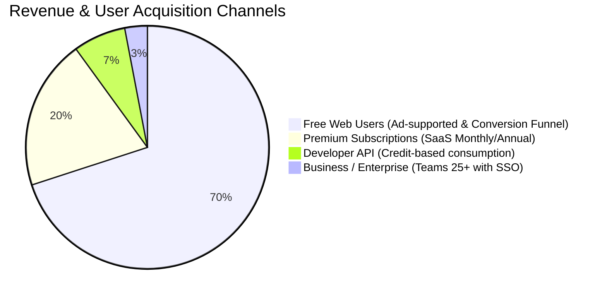
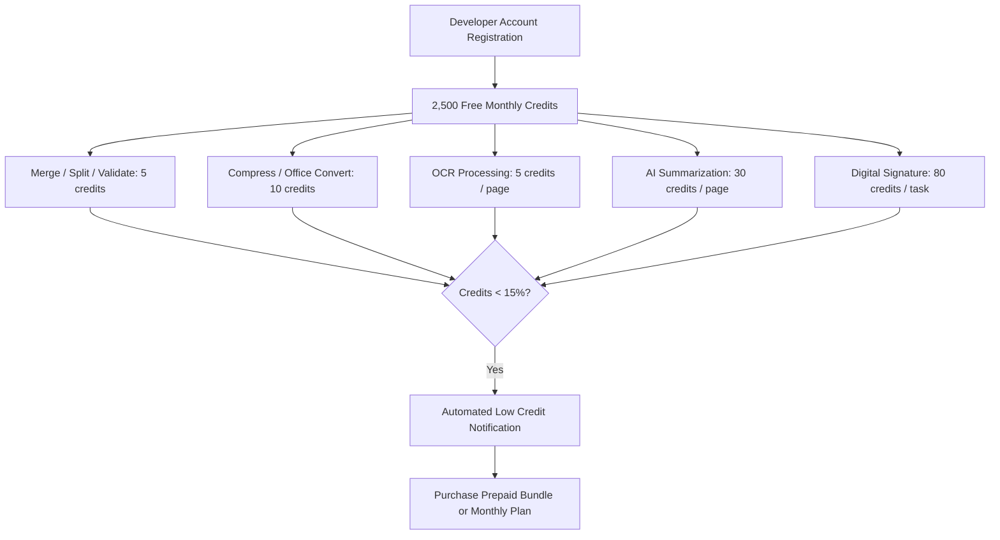

# Pricing Analysis, File Limits & Commercial Architecture

**Document Type:** Commercial Model Analysis & Tier Restriction Matrix  
**Status:** Phase 1 — Iteration 2 (Evidence-Verified & Audited)  
**Reference Target:** [iLovePDF (ilovepdf.com)](https://www.ilovepdf.com/)  
**Audit Register:** [`research/evidence-register.md`](file:///e:/REA/research/evidence-register.md)  
**Inspection Evidence:** [`ilovepdf_pricing_screenshot.png`](file:///e:/REA/research/ilovepdf_pricing_screenshot.png), [`ilovepdf_pricing_a11y.txt`](file:///e:/REA/research/ilovepdf_pricing_a11y.txt)  

---

## 1. Verified Commercial Plan Overview

Inspected directly on `https://www.ilovepdf.com/pricing` via Chrome CDP:

### Verified Tier Comparison Matrix

| Attribute | Basic (Free) | Premium (Web + Desktop + Mobile) | Business / Enterprise | Developer REST API (`iloveapi.com`) |
| :--- | :--- | :--- | :--- | :--- |
| **Pricing** | $0 / forever | • Global: $9/mo (monthly) or $5/mo ($60 billed annually, -42% discount) • Regional (e.g. India): ₹242/mo (₹2,900 billed annually) | Custom quote (Tiered by seat count, 25+ users) | • Free tier: 2,500 credits/mo • Paid packages start at ~$5–$20+ |
| **Access Modalities** | Web browser only | Web, Desktop (Windows/macOS), Mobile (iOS/Android) | Web, Desktop, Mobile, Dedicated Server/On-Premise | REST API (`iloveapi.com`), SDKs (Node, Python, PHP) |
| **Advertising** | Ad-supported (Display banners) | 100% Ad-free experience | 100% Ad-free experience | N/A (Headless) |
| **Document Processing** | Limited document processing | Unlimited document processing | Unlimited document processing | Governed by monthly credit balance |
| **Max File Size** | 15 MB to 100 MB per file (tool-dependent) | **Up to 4 GB** per operation (marketed as "Unlimited") | **Up to 4 GB+** (customizable) | Default 100 MB–1 GB per request |
| **Batch Processing** | Heavily restricted (e.g. max 1–10 files) | Up to **500+ files** per single batch task | Custom batch sizes | Batch API endpoints available |
| **OCR Capabilities** | Disabled or 1-page sample only | Full multi-language OCR across all conversion tools | Full multi-language OCR | 5 credits / page OCR |
| **AI Features** | None / trial only | **2,000 AI Credits** included | Custom AI credit allocation | 30 credits / page |
| **E-Signatures** | Simple Electronic Signature (single signer) | Advanced digital certificates (audit trail, multiple signers) | Team signing workflows, audit vault | 80 credits / signature task |
| **Customer Support** | Basic / FAQ | Priority / Preferential support | Dedicated Account Manager, 99.9% SLA | Developer ticket support |
| **Authentication** | Optional (anonymous usage supported) | Single user credential (1 to 25 users) | Single Sign-On (SSO / SAML 2.0) | API Keys & JWT Bearer Tokens |
| **Workflows** | No | Included (chain up to 4 tools) | Included | Webhook / API pipelines |

---

## 2. Publicly Stated File Limits & Restriction Matrix

The platform calibrates file size and batch ceilings based on server resource intensity:

| Tool Category | Tool Name | Free Plan Limits | Premium Plan Limits | Commercial Upsell Trigger |
| :--- | :--- | :--- | :--- | :--- |
| **Organize** | Merge PDF | • Max 25 files • Max 100 MB total | • Max 500 files • Up to 4 GB total | Prompt triggered on dragging 26th file or exceeding 100 MB |
| **Organize** | Split PDF | • Max 1 file • Max 100 MB | • Max 1 file • Up to 4 GB | Prompt triggered on file size > 100 MB |
| **Optimize** | Compress PDF | • Max 2 files per batch • Max 100 MB | • Max 10 files per batch • Up to 4 GB | High-compression preset lock; batch size trigger |
| **Optimize** | OCR PDF | • Disabled or 1 page demo | • Unlimited pages • Multi-language recognition | Locked tool icon on free tier |
| **Convert** | Word/Excel/PPT to PDF | • Max 15–25 MB per file • Max 1–3 files batch | • Up to 4 GB • Up to 500 files | Oversized document alert with upgrade modal |
| **Convert** | PDF to Word/Excel | • Text layer only (non-scanned) • Max 15 MB | • OCR-enabled layout reconstruction • Up to 4 GB | "Document contains scanned text — upgrade to OCR" prompt |
| **Convert** | JPG to PDF | • Max 20 images batch • Max 25 MB | • Max 100+ images • Up to 4 GB | Batch threshold trigger |
| **Security** | Sign PDF | • Simple visual signature • 1 signature request/month | • Legally binding digital certificate • Unlimited signature requests | Multi-party request or digital cert toggle |
| **Intelligence**| AI Summarizer | • 1–2 test queries | • 2,000 monthly credits | Prompt to subscribe upon exhausting query tokens |

---

## 3. Developer API Economics (`iloveapi.com`)

The developer platform charges on an atomic **task consumption basis** using credits:

### Verified API Task Cost Breakdown

| API Operation | Credit Cost per Unit | Rationale & Compute Profile | Verification Source |
| :--- | :---: | :--- | :--- |
| **Merge / Split / Rotate** | 5 credits | Low CPU, I/O bound stream stitching | `iloveapi.com/pricing` |
| **PDF to Markdown / Validate PDF/A** | 5 credits | Moderate AST extraction / validation parsing | `iloveapi.com/pricing` |
| **Compress PDF** | 10 credits | High CPU raster recompression & downsampling | `iloveapi.com/pricing` |
| **Office to PDF (Word, Excel, PPT)** | 10 credits | Headless LibreOffice / virtual printing worker execution | `iloveapi.com/pricing` |
| **HTML to PDF** | 10 credits | Chromium headless DOM rendering & network capture | `iloveapi.com/pricing` |
| **Forms Detect** | 20 credits / page | AcroForm heuristic analysis | `iloveapi.com/pricing` |
| **PDF OCR** | 5 credits / page | Compute-intensive Tesseract / OCR pipeline | `iloveapi.com/pricing` |
| **AI Summarizer** | 30 credits / page | Upstream foundational LLM token costs | `iloveapi.com/pricing` |
| **Digital Legal Signature** | 80 credits / task | Cryptographic PKCS#7 / PAdES signing & audit vaulting | `iloveapi.com/pricing` |

---

## 4. Fact vs. Assumption Ledger

| ID | Statement | Classification | Verification Source |
| :--- | :--- | :--- | :--- |
| **F-08** | Premium costs $9/mo or $60/yr ($5/mo equivalent, 42% discount). Regional variations apply. | Verified Fact | Direct live inspection of `/pricing` (`ilovepdf_pricing_a11y.txt`). |
| **F-09** | Basic tier includes 0 AI credits and no desktop/mobile access; Premium includes 2,000 AI credits and full cross-platform access. | Verified Fact | Direct live inspection of `/pricing` comparison table. |
| **F-10** | Developer API grants 2,500 free monthly credits with per-task credit costs ranging from 5 to 80 credits. | Verified Fact | Official API documentation (`iloveapi.com/pricing`). |
| **A-04** | Free tier bandwidth is throttled using leaky-bucket rate limiting middleware. | Technical Assumption | Standard architectural best practice for multi-tenant SaaS platforms. |
