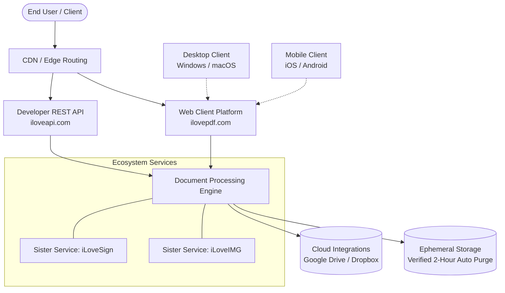
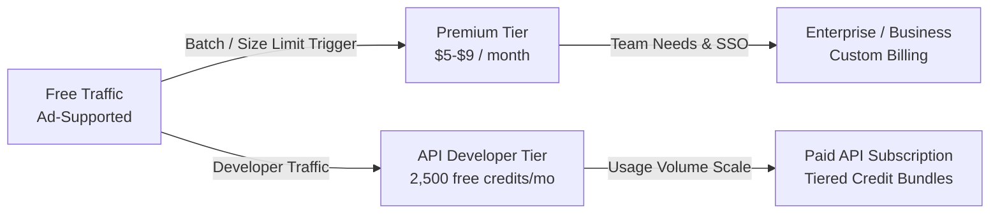

# Product Overview: iLovePDF Analysis & Independent Engineering Architecture

**Document Type:** Strategic Product Analysis & Independent Architecture Blueprint  
**Status:** Phase 1 — Iteration 2 (Evidence-Verified & Audited)  
**Reference Target:** [iLovePDF (ilovepdf.com)](https://www.ilovepdf.com/)  
**Audit Register:** [`research/evidence-register.md`](file:///e:/REA/research/evidence-register.md)  
**Date:** November 2026  
**Audience:** Engineering Leadership, Product Architects  

---

## 1. Executive Summary

iLovePDF is a high-volume, cloud-first document management platform specializing in portable document format (PDF) operations. Founded in Barcelona in 2010, the service has evolved from a basic two-tool utility (Merge and Split) into a comprehensive document suite handling tens of millions of documents daily across web, mobile, desktop, and developer API interfaces.

This document establishes the product landscape, user personas, monetization model, and data privacy principles of the reference benchmark to inform the design of an independently engineered, modern, cloud-native PDF processing platform. All core factual claims have been verified against primary browser inspection data and official documentation.

---

## 2. Core Value Proposition

The foundational value proposition of a modern PDF platform consists of:

1. **Zero-Friction Utility:** Instant browser-based document processing without mandatory account creation or software installation for standard single-task workflows.
2. **Comprehensive Document Lifecycle:** Single-destination coverage across all document operations: organizing, converting, optimizing, editing, securing, and AI analysis.
3. **Cross-Platform Parity:** Fluid transition across browser web applications, desktop native applications (offline processing), native mobile applications (scanner-integrated), and developer REST APIs.
4. **Data Privacy by Default:** Ephemeral storage model ensuring short document retention windows (verified 2-hour automated purge) with immediate user-initiated shredding options.

---

## 3. Reference Platform Ecosystem

### Platform Delivery Channels

| Platform Channel | Delivery Method | Target Scenario | Execution Model |
| :--- | :--- | :--- | :--- |
| **Web Platform** | SPA / Server-Rendered Web App | Ad-hoc single file and small batch tasks from any browser | Hybrid: Client-side parsing + Ephemeral server worker processing |
| **Desktop Application** | Native / Electron (Windows, macOS) | High-volume batch operations, sensitive corporate files | Local processing (air-gapped/offline) + Optional cloud sync |
| **Mobile Application** | Native (iOS, Android) | On-the-go scanning, mobile signing, quick modifications | Native device camera scanning + Cloud API worker processing |
| **Developer API** | REST API (`iloveapi.com`) | Programmatic integration into third-party SaaS, ERP, workflows | Token/Key authenticated, credit-based usage tiers |
| **No-Code Extensions** | Zapier, Make, n8n, Google Workspace | Automated document pipelines without code | Webhook / API triggered automated task sequences |

---

## 4. Target User Personas

1. **Casual Web User (Ad-hoc Consumer)**
   * *Needs:* Merge receipts, compress a resume for a job portal, convert an image to PDF.
   * *Behavior:* Seeks zero friction, lands directly via organic search on a specific tool URL, leaves immediately after downloading. High demand centered around Merge, Split, and Compress as evidenced by their primary placement in the global navigation bar.
   * *Monetization:* Ad monetization, conversion prompt upon hitting file/size thresholds.

2. **Students & Academic Professionals**
   * *Needs:* Merge lecture slides, convert research papers to Word, split textbook chapters, OCR scanned lecture notes.
   * *Behavior:* High frequency, low willingness to pay directly; highly responsive to academic verification discounts (verified: 1 free year of Premium via `/education`).
   * *Monetization:* Long-term brand affinity, student tier conversions, eventual enterprise pipeline.

3. **Business Professionals & Legal Teams**
   * *Needs:* Contract e-signatures, document comparison, redaction of sensitive records, secure PDF encryption, PDF/A archiving.
   * *Behavior:* High compliance sensitivity, requires strict privacy guarantees, willingness to pay for premium desktop/web subscription.
   * *Monetization:* Recurring monthly/annual SaaS subscription ($5–$9/seat/mo globally; regional pricing available).

4. **Software Developers & System Integrators**
   * *Needs:* Automated invoice generation, automated PDF compression pipeline, programmatic text extraction, batch OCR.
   * *Behavior:* Integrates via REST API, requires predictable latency, high uptime, structured JSON responses, webhooks.
   * *Monetization:* Monthly credit subscriptions (2,500 free credits/mo grant) and prepaid volume packages.

5. **Enterprise Organizations (Teams 25+)**
   * *Needs:* Centralized billing, Single Sign-On (SSO / SAML), audit logging, compliance SLA, custom data retention rules.
   * *Behavior:* Procured via IT departments with formal compliance reviews.
   * *Monetization:* Custom contract, dedicated account management.

---

## 5. Monetization & Business Model

The platform utilizes a multi-tiered **Freemium & API-driven** revenue model:

* **Ad Monetization:** Programmatic display advertisements displayed on upload and post-processing screens for non-authenticated free users.
* **SaaS Subscriptions:** Premium Web + Desktop + Mobile access billed at $9/month (monthly) or $60/year ($5/month equivalent, 42% discount). Regional variations apply (e.g. ₹242/mo in India).
* **API Consumption Fees:** Freemium credit model (2,500 credits free/month), scaling to tiered monthly subscriptions with per-credit cost reductions at scale.

---

## 6. Privacy, Security & Compliance Baseline

| Security Area | Publicly Documented Standard | Engineering Significance for Independent Platform | Verification Status |
| :--- | :--- | :--- | :---: |
| **In-Transit Encryption** | HTTPS / TLS 1.3 encryption across all endpoints | Strict transport security required; all worker communication encrypted | **VERIFIED** |
| **File Retention Policy** | Standard processing files automatically deleted within **2 hours** | Worker nodes must implement rigorous TTL (Time-To-Live) cleanup cron / ephemeral volumes | **VERIFIED** |
| **Manual Data Destruction** | Immediate user-initiated delete button on download screen | Instant cache purge and storage deletion endpoint | **VERIFIED** |
| **Legal Document Retention** | Signed electronic documents retained up to **5 years** (eIDAS compliance) | Dedicated legal vault storage separate from ephemeral processing workers | **VERIFIED** |
| **AI Model Training** | Explicit guarantee: User documents are **not** used to train AI models | Zero-data-retention agreements required with foundational AI API providers | **VERIFIED** |
| **Regulatory Standards** | ISO/IEC 27001 ISMS certification, EU GDPR compliance | Data residency options, GDPR Data Processing Agreements (DPA) | **VERIFIED** |

---

## 7. Fact vs. Assumption Ledger

| ID | Statement | Classification | Supporting Evidence / Source |
| :--- | :--- | :--- | :--- |
| **F-01** | Platform offers 33 distinct tools grouped across 7 categories. | Verified Fact | Verified via live browser DOM and accessibility tree inspection (`ilovepdf.com`). |
| **F-02** | Standard files are permanently purged within 2 hours of processing. | Verified Fact | Official Privacy & Security FAQ (`ilovepdf.com/help/faq`). |
| **F-03** | Premium tier provides up to 4 GB file sizes and 500+ batch conversions. | Verified Fact | Public pricing and technical documentation (`ilovepdf.com/pricing`). |
| **F-04** | Developer API provides 2,500 free monthly credits on registration. | Verified Fact | Official developer portal documentation (`iloveapi.com`). |
| **A-01** | Client-side thumbnail rendering uses client-side PDF.js rendering. | Technical Assumption | Architectural deduction based on observed zero-network-latency page previews. |
| **A-02** | Backend conversion workers execute in containerized Linux sandboxes. | Technical Assumption | Security industry requirement for untrusted document processing. |
