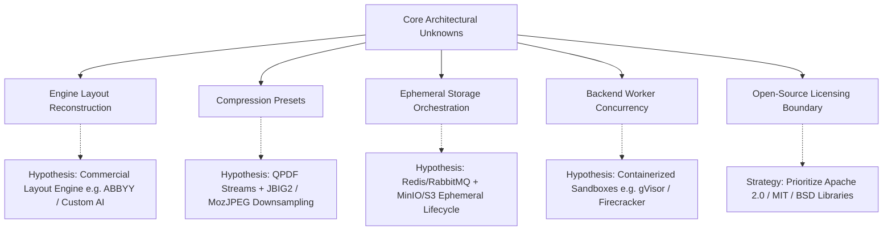

# Research Unknowns, Technical Hypotheses & Legal Boundaries

**Document Type:** Risk Register, Architectural Unknowns & Investigation Boundaries  
**Status:** Phase 1 — Iteration 2 (Evidence-Verified & Audited)  
**Reference Target:** [iLovePDF (ilovepdf.com)](https://www.ilovepdf.com/)  
**Audit Register:** [`research/evidence-register.md`](file:///e:/REA/research/evidence-register.md)  

---

## 1. Technical Unknowns & Architectural Hypotheses

While publicly accessible documentation and REA browser observations expose high-level workflows and API structures, several deep architectural implementation details remain proprietary and unverified.



### Unknown 1: Layout Reconstruction Engine for PDF-to-Office Conversions
* **The Unknown:** Converting a PDF back to an editable Word document (`.docx`) or Excel spreadsheet (`.xlsx`) with identical paragraph flow, font matches, tab stops, and multi-line table cells is one of the hardest problems in document computing. The exact layout reconstruction pipeline used by iLovePDF is undocumented.
* **Working Hypothesis:** The reference platform likely utilizes a commercial layout analysis SDK (such as *Solid Documents*, *ABBYY FineReader Engine*, or a proprietary machine-learning model trained on document element bounding boxes) rather than basic open-source scripts like `pdf2docx`.
* **Independent Path Forward:** For our independent platform, start with open-source layout extractors (`pdfplumber`, `Camelot`, `pdf2docx`, `PaddleOCR`) for MVP, benchmark accuracy on standard financial/legal documents, and assess if a dedicated ML layout model (e.g., LayoutLMv3) is necessary for high fidelity.

### Unknown 2: Compression Optimization Architecture (Resolved in ADR-001 Revision 3)
* **The Unknown:** Achieving high-ratio PDF compression matching proprietary engines without incurring AGPL-3.0 copyleft liability from Ghostscript.
* **Resolution (ADR-001 Rev 3):** Implemented a dual-pass open architecture:
  1. *Raster Image Downsampling (Pillow, HPND/MIT):* Traverses `/XObject` dictionaries, handles `/SMask` transparency, respects CMYK/ICC profiles, bypasses spot colors, resamples geometry using Lanczos filtering to target resolutions (72, 144, 200 DPI), and re-encodes streams using optimized MozJPEG/JPEG quantization.
  2. *Structural Optimization (pikepdf / QPDF 11+, MPL-2.0 / Apache 2.0):* Compresses indirect objects into Object Streams (`/ObjStm`), converts cross-reference tables to streams (`/XRef`), normalizes FlateDecode streams, strips unused metadata, deduplicates font streams, and applies Fast Web View linearization.
  3. *Validation Spike & Benchmark:* A dedicated Proof of Concept (PoC) spike in Sprint 2 validates transparency, CMYK, and signed PDF handling. A reproducible 100-document benchmark in Sprint 5 measures empirical compression ratios and SSIM/PSNR visual quality.
* **Status:** Resolved for MVP implementation. Eliminates AGPL exposure while maintaining strict image fidelity.

### Unknown 3: Ephemeral File Storage & Automated Shredding Lifecycle (Resolved in ADR-001 Revision 3)
* **The Unknown:** The precise mechanism ensuring documents are guaranteed purged within 2 hours.
* **Resolution (ADR-001 Rev 3):** Reconciled three-tier cleanup architecture:
  1. *Tier 1 (Synchronous Worker Cleanup):* Worker task unlinks local scratch files and purges `/tmp/pdf_jobs/{job_id}` in a `try...finally` block immediately upon completion or failure.
  2. *Tier 2 (Active 10-Minute Sweeper):* Celery Beat cron runs every 10 minutes, querying PostgreSQL for jobs older than 2 hours with `purged_at IS NULL`. It issues batch S3 `DeleteObjects` calls, aborts incomplete multipart uploads, and updates the database record. Maximum expected cleanup delay is bounded at $T_0 + 135\text{ minutes}$.
  3. *Tier 3 (Infrastructure Failsafe):* S3/MinIO bucket lifecycle policies enforce a 24-hour expiration rule and an `AbortIncompleteMultipartUpload: DaysAfterInitiation: 1` rule. Object versioning is explicitly disabled.

### Unknown 4: Concurrency, Sandboxing & Operation-Specific PDF Sanitization (Resolved in ADR-001 Revision 3)
* **The Unknown:** How backend workers process arbitrary, untrusted user PDFs without risking node compromise, denial of service, or breaking legitimate document features.
* **Resolution (ADR-001 Rev 3):**
  1. *Operation-Specific Sanitization:* Replaced blanket stripping with contextual rules: preserve `/URI` hyperlinks in Merge/Compress; preserve `/OpenAction` if pointing to valid destinations; preserve data attachments (`.xml`, e-invoices) while stripping executable extensions (`.exe`, `.bat`, `.js`); always strip `/Launch`.
  2. *Flate Bomb Protection:* Stream expansion monitored in real time; abort if expansion ratio $> 50:1$ or uncompressed size $> 200\text{ MB}$.
  3. *Hardened Worker Sandbox:* Unprivileged user (`uid=10001`), read-only root, RAM-backed tmpfs (`size=256m`), dropped capabilities (`CAP_DROP=ALL`), `gVisor` (`runsc`) user-space kernel isolation, and cgroups limits (512 MB RAM, 1.0 CPU, 60s timeout).

### Unknown 5: Download Authorization & Failure Recoverability (Resolved in ADR-001 Revision 3)
* **The Unknown:** Balancing strict single-use replay protection with client recoverability during transient S3 streaming disconnects.
* **Resolution (ADR-001 Rev 3):** Implemented a leased token authorization flow:
  1. Issuance of a 15-minute base token stored in a Redis Hash.
  2. Atomic redemption via Redis Lua script: first request activates a **120-second lease window** allowing up to 3 retry attempts and HTTP `Range` chunked resume.
  3. Storage errors (500/503 from S3) trigger state rollback.
  4. Token is permanently evicted upon lease expiration, returning HTTP 410 Gone for replay attempts.

### Unknown 5: Open-Source Licensing Compliance & AGPL Obligations

A critical engineering and legal requirement is auditing open-source licensing to protect the independent platform's proprietary codebase:

```
[ Licensing Spectrum for PDF Processing Components ]

PERMISSIVE (No Copyleft Obligations):
├── QPDF:          Apache 2.0 (Permissive; commercial use, modification & distribution permitted)
├── PDF.js:        Apache 2.0 (Mozilla client-side rendering engine)
├── PDFium:        3-Clause BSD (Chromium's embedded PDF engine)
├── Tesseract:     Apache 2.0 (Optical character recognition engine)
├── Gotenberg:     MIT (Stateless Docker API microservice)
└── pdf-lib:       MIT (Client and server JavaScript manipulation)

WEAK COPYLEFT (File-Level Copyleft; Safe as Subprocesses / Microservices):
├── LibreOffice:   MPL 2.0 / LGPLv3+ (No network copyleft; safe to run headlessly in containers)
└── OCRmyPDF:      MPL 2.0 (Weak copyleft; unmodified execution does not affect caller)

STRONG NETWORK COPYLEFT (AGPL-3.0 — High Commercial Scrutiny):
└── Ghostscript / MuPDF: AGPL-3.0 (Artifex Software)
```

#### Detailed Legal & Technical Analysis of AGPL-3.0 (Section 13):
* **The Network Clause:** Section 13 of the AGPL-3.0 specifies that if you modify the software and run it on a server accessible over a network, you must make the corresponding source code of the modified work available to all remote users.
* **CLI Execution vs. Deep Linking:**
  * If an application *dynamically or statically links* against Ghostscript (`libgs`) or MuPDF libraries, the entire calling backend becomes a derivative work under copyright law, triggering full AGPL copyleft obligations across the proprietary platform.
  * If Ghostscript is executed as an *unmodified, standalone command-line binary via a standard operating system pipe / `exec` subprocess*, legal precedent generally views it as an independent program invocation rather than a derivative work. However, Artifex Software actively and aggressively enforces dual-licensing claims in commercial contexts (e.g., *Artifex Software, Inc. v. Hancom, Inc.*).
* **Independent Architecture Strategy:**
  1. **Default Rule:** Exclude AGPL-licensed software (`Ghostscript`, `MuPDF`) from the core codebase. Replace them with **Apache 2.0** alternatives (`QPDF` for structural manipulation, `PDFium` for rendering, `Tesseract` for OCR).
  2. **LibreOffice Safety:** Note that `LibreOffice` is licensed under **MPL 2.0 / LGPLv3+**, NOT AGPL. Orchestrating LibreOffice headlessly via Gotenberg (MIT) carries **no AGPL risk** and does not require open-sourcing the SaaS platform.
  3. **Conditional AGPL Exception:** If Ghostscript's specialized PostScript or PDF/A conversion features are deemed indispensable in Phase 3, deploy it inside a completely isolated, standalone container service, or procure an Artifex commercial OEM license.

---

## 2. Ethical & Legal Investigation Boundaries (REA Permitted Scope)

When applying Reverse-Engineer-Anything (REA) capabilities to analyze reference platforms, strict ethical, legal, and operational boundaries must be maintained:

```
+-----------------------------------------------------------------------------------------+
|                               PERMITTED REA CAPABILITIES                                |
|  [x] Passive DOM & accessibility inspection (inspect_web_page)                          |
|  [x] Visual layout & responsive viewport analysis (capture_web_screenshot)              |
|  [x] Public network traffic & asset flow observation (inspect_web_network_capture)      |
|  [x] Publicly documented API contract discovery (discover_webmcp_tools)                 |
|  [x] Documenting observable user-facing states & interaction sequences                  |
+-----------------------------------------------------------------------------------------+
                                           VS
+-----------------------------------------------------------------------------------------+
|                                PROHIBITED ACTIVITIES                                    |
|  [!] NO downloading or decompiling proprietary JavaScript source maps                   |
|  [!] NO extracting, decompiling, or reconstructing proprietary backend source code      |
|  [!] NO accessing private, restricted, or undocumented backend endpoints                |
|  [!] NO bypassing authentication, paywalls, or rate limits                              |
|  [!] NO scraping, cloning, or reproducing proprietary brand assets, logos, or icons     |
|  [!] NO claiming factual knowledge of undocumented internal cloud infrastructure         |
+-----------------------------------------------------------------------------------------+
```

---

## 3. Fact vs. Assumption Ledger

| ID | Finding / Statement | Classification | Verification Source |
| :--- | :--- | :--- | :--- |
| **F-13** | Ghostscript is licensed under AGPL-3.0 with commercial licensing available from Artifex. | Verified Fact | Official Artifex Licensing Documentation. |
| **F-14** | `QPDF` is licensed under Apache 2.0, permitting commercial use without copyleft obligations. | Verified Fact | Official QPDF GitHub LICENSE. |
| **F-15** | `LibreOffice` is licensed under MPL-2.0 / LGPLv3+, NOT AGPL. | Verified Fact | Official Document Foundation Licensing Documentation. |
| **F-16** | `Gotenberg` is licensed under MIT. | Verified Fact | Official Gotenberg GitHub LICENSE. |
| **A-06** | Complex layout preservation in PDF-to-Word is powered by commercial third-party SDKs. | Technical Assumption | Architectural analysis of the document processing market. |
| **A-07** | Worker execution environments are hardened against PDF CVE exploits using containerized cgroups. | Technical Assumption | Security best practice in multi-tenant processing. |
